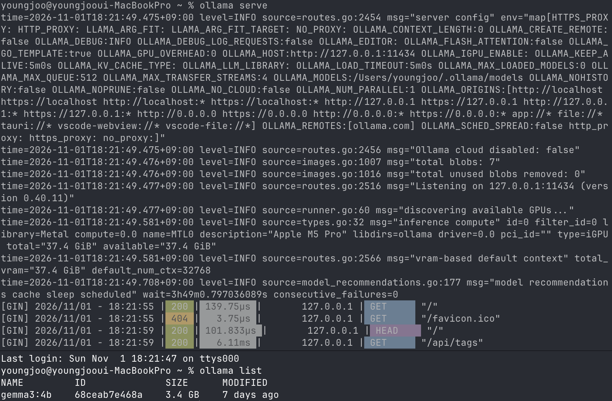

1주차에는 Mac에 Ollama를 설치하고 터미널에서 모델과 대화했다. 2주차에는 Python으로 질문을 보내고, 답변을 스트리밍으로 출력하고, 대화 기록을 관리하는 코드를 공부했다.

범위는 『Build Applications with Local AI Models on a Mac』 CH4~7이다. 모델 크기와 양자화, VS Code와 Python 가상환경, Ollama Python 라이브러리 사용법을 정리했다.

## 1. Python에서 모델까지


%%{init: {"flowchart": {"rankSpacing": 24, "padding": 10}}}%%
flowchart TB
    subgraph MAC["내 Mac"]
        V["VS Code<br>코드 작성·실행"]
        P["Python 프로그램<br>질문·기록·출력 관리"]
        L["Ollama 라이브러리<br>요청·응답 처리"]
        S["Ollama 서버<br>127.0.0.1:11434"]
        M["모델 실행<br>Gemma 3 가중치로 추론"]

        V -. "코드 작성" .-> P
        P --> L
        L -->|"HTTP 요청"| S
        S --> M
        M -->|"생성 결과"| S
        S -->|"HTTP 응답"| L
        L --> P
    end


VS Code에서 작성한 Python 코드가 Ollama 라이브러리를 호출한다. 라이브러리는 로컬 서버에 HTTP 요청을 보내고, 서버는 모델을 실행해 응답을 돌려준다. Python에서는 이 응답을 출력하거나 파일에 저장한다.

| 구성 요소 | 역할 |
|---|---|
| VS Code | 코드 편집·실행·디버깅 |
| Python 프로그램 | 질문, 대화 기록, 출력 관리 |
| Ollama Python 라이브러리 | 서버 요청과 응답 처리 |
| Ollama 서버 | 모델 로딩과 추론 관리 |
| 모델 가중치 | 응답 계산에 사용하는 학습된 수치 |

실습에는 Ollama 실행 도구, `gemma3:4b` 모델 파일, Python의 `ollama` 패키지를 사용한다. [Ollama Python 라이브러리](https://github.com/ollama/ollama-python)

## 2. 모델 크기와 양자화

`gemma3:4b`의 `gemma3`는 모델 계열이고, `4b`는 약 40억 개 규모의 파라미터를 가진 버전을 뜻한다.

파라미터는 학습 과정에서 조정되는 수치다. 학습을 마친 가중치를 내려받아 입력에 대한 출력을 계산하는 과정이 추론이다. 많은 수치가 함께 작용하며 학습한 언어 패턴을 표현한다.

파라미터 수가 늘면 더 복잡한 패턴을 표현할 여지가 커진다. 답변 품질에는 학습 데이터와 학습 방식, 모델 구조, 질문의 종류도 영향을 준다. 내 Mac에서 사용할 모델은 답변 품질, 생성 속도, 메모리 사용량을 함께 보며 고르려고 한다.

수업의 기준 모델은 `gemma3:4b`다. [Gemma 3 모델 정보](https://ollama.com/library/gemma3:4b)

### 숫자를 저장하는 정밀도

양자화는 모델의 수치를 더 낮은 정밀도로 표현해 저장·실행에 필요한 공간을 줄이는 방법이다.

40억 개의 가중치를 모두 같은 비트 수로 저장한다고 가정하면 다음처럼 계산할 수 있다.

> 가중치 저장량 ≈ 파라미터 수 × 파라미터당 비트 수 ÷ 8

| 정밀도 | 가중치의 이론적 저장량 |
|---|---:|
| 16비트 | 약 8GB |
| 8비트 | 약 4GB |
| 4비트 | 약 2GB |

*4B 모델의 가중치만 계산한 값. 단위는 십진 GB.*

실제 모델 파일에는 양자화에 필요한 추가 정보가 포함되고, 구성 요소마다 정밀도가 다를 수 있다. 실행 중에는 가중치에 더해 문맥 처리용 캐시와 작업 공간을 사용한다.

파라미터 수가 같아도 양자화 방식에 따라 파일 크기와 메모리 사용량이 달라진다. 낮은 정밀도를 적용했을 때 답변 품질이 얼마나 달라지는지도 비교할 항목이다. [Hugging Face 양자화 설명](https://huggingface.co/docs/transformers/quantization/overview)

## 3. 모델 다운로드와 실행

내려받은 모델 파일은 디스크에 보관된다. 대화를 요청하면 모델을 메모리에 준비하고 입력을 처리한다. 응답 후에는 설정에 따라 모델을 메모리에 유지하다가 해제한다.


%%{init: {"flowchart": {"rankSpacing": 24, "padding": 10}}}%%
flowchart TD
    A["모델 다운로드"] --> B["디스크에 모델 파일 보관"]
    B --> C["대화 요청"]
    C --> D{"모델이 메모리에<br>준비되어 있는가?"}
    D -->|"아니요"| E["모델 로딩·실행 준비"]
    D -->|"예"| F["입력 처리·응답 생성"]
    E --> F
    F --> G["응답 반환"]
    G --> H["설정에 따라 메모리에 유지"]
    H --> I["언로드 후에도<br>디스크의 모델 파일은 유지"]


| 명령어 | 동작 |
|---|---|
| `ollama pull gemma3:4b` | 모델 다운로드 |
| `ollama list` | 로컬 모델 목록 |
| `ollama show gemma3:4b` | 파라미터 수, 양자화 등 상세 정보 |
| `ollama run gemma3:4b` | 대화 시작 |
| `ollama ps` | 현재 로드된 모델 확인 |
| `ollama stop gemma3:4b` | 모델 언로드 |
| `ollama rm gemma3:4b` | 로컬 모델 삭제 |

`list`는 디스크에 보관된 모델을, `ps`는 현재 메모리에 로드된 모델을 보여준다. 처음 요청할 때는 모델 로딩 시간이 포함될 수 있다. [Ollama CLI 문서](https://docs.ollama.com/cli)

`ollama ps`의 `PROCESSOR` 열에는 모델의 CPU·GPU 배치 상태가 표시된다. 실제 연산 중 GPU 이용률은 활동 상태 보기 등의 도구로 확인한다.

### 서버 실행과 모델 목록

한 터미널에서 서버를 실행하고, 다른 터미널에서 모델 목록을 조회했다.

```sh
ollama serve
```

```sh
ollama list
```



Ollama `0.40.11`이 `127.0.0.1:11434`에서 실행 중이다. 서버 로그에 `Apple M5 Pro`와 `Metal`이 표시됐고, 모델 목록에는 `gemma3:4b`가 `3.4 GB`로 나왔다. 모델 ID는 `68ceab7e468a`다.

## 4. Python 가상환경

프로젝트마다 필요한 패키지와 버전이 다르다. 가상환경을 만들면 각 프로젝트의 Python 패키지를 나누어 관리할 수 있다.


%%{init: {"flowchart": {"rankSpacing": 24, "padding": 10}}}%%
flowchart TB
    subgraph SHARED["패키지 환경을 공유하는 경우"]
        A["프로젝트 A<br>패키지 1.x 필요"] --> X["공유 설치 환경<br>버전 충돌 가능"]
        B["프로젝트 B<br>패키지 2.x 필요"] --> X
    end

    subgraph ISOLATED["가상환경으로 분리하는 경우"]
        C["챗봇 프로젝트"] --> E["챗봇용 .venv<br>필요한 패키지와 버전"]
        D["다른 프로젝트"] --> F["별도의 .venv<br>다른 패키지와 버전"]
    end


수업 자료는 Python 3.13의 `venv`와 `pip`를 기본으로 사용한다.

```sh
mkdir -p ~/local-ai-study/week-02
cd ~/local-ai-study/week-02

python3.13 -m venv .venv
source .venv/bin/activate

python --version
python -c "import sys; print(sys.executable)"
python -m pip --version
```

`venv`는 환경을 만드는 모듈이고, `.venv`는 생성할 폴더 이름이다. `source .venv/bin/activate`를 실행하면 현재 셸의 `PATH`가 바뀌어 해당 환경의 Python을 우선 사용한다.

프로젝트에서 사용하는 Python의 위치는 `sys.executable`로 확인한다. 활성화를 해제할 때는 `deactivate`, 실행 파일을 직접 지정할 때는 `.venv/bin/python`을 쓴다. [Python 가상환경 문서](https://docs.python.org/3.13/library/venv.html)

영상에서는 `uv`로 Python 3.13 환경을 만드는 방법도 소개했다. 아래는 환경 생성의 대안이다.

```sh
uv venv --python 3.13 --seed
source .venv/bin/activate
```

`--seed`는 `pip` 같은 기본 패키지 관리 도구를 환경에 준비하는 옵션이다. [uv 환경 안내](https://docs.astral.sh/uv/pip/environments/)

### VS Code 설정

프로젝트 폴더를 열고 Microsoft의 Python 확장을 설치한다. 명령 팔레트의 `Python: Select Interpreter`에서 프로젝트의 `.venv`를 선택한다.

터미널과 VS Code가 같은 Python 환경을 사용하도록 맞춘다. [VS Code의 Python 환경 설정](https://code.visualstudio.com/docs/python/environments)

### 패키지 설치와 환경 기록

`ollama` 패키지를 설치한다. Streamlit은 이후 웹 화면을 만들 때 사용한다.

```sh
python -m pip install ollama
python -m pip install streamlit
```

설치된 패키지와 버전은 `requirements.txt`로 남긴다.

```sh
python -m pip freeze > requirements.txt
```

새 환경에서는 이 파일을 읽어 패키지를 설치한다.

```sh
python -m pip install -r requirements.txt
```

프로젝트를 공유할 때는 소스 코드, `requirements.txt`, Python 버전을 함께 남기고 `.venv`는 각 환경에서 다시 만든다. [pip freeze 문서](https://pip.pypa.io/en/stable/cli/pip_freeze/)

## 5. Python으로 질문 보내기

Ollama 서버와 `gemma3:4b`를 준비한 뒤 `chat_basic.py`에 다음 코드를 작성한다.

```python
from ollama import Client

client = Client(host="http://127.0.0.1:11434")

response = client.chat(
    model="gemma3:4b",
    messages=[
        {
            "role": "user",
            "content": "로컬 AI가 무엇인지 한국어로 세 문장으로 설명해줘.",
        }
    ],
    stream=False,
)

print(response.message.content)
```

가상환경의 터미널에서 실행한다.

```sh
python chat_basic.py
```

| 코드 | 역할 |
|---|---|
| `Client(...)` | 요청할 서버 주소 |
| `model` | 사용할 모델 |
| `messages` | 전달할 대화 목록 |
| `stream=False` | 완성된 응답을 한 번에 받는 설정 |
| `response.message.content` | 답변 텍스트 |

응답을 Python 값으로 받으면 화면 출력, 파일 저장, 다른 프로그램과의 연결에 사용할 수 있다. [Ollama Python 사용법](https://github.com/ollama/ollama-python)

### 메시지의 역할

| 역할 | 내용 |
|---|---|
| `system` | 응답 방식과 역할에 관한 지시 |
| `user` | 사용자의 질문과 요청 |
| `assistant` | 모델의 이전 답변 |

같은 질문에도 `system` 지시를 다르게 줄 수 있다.

- “초보자를 가르치는 튜터처럼 비유를 들어 설명해.”
- “개발자에게 설명하듯 원리를 간결하게 정리해.”

모델은 역할 지시와 질문을 함께 문맥으로 받는다. 지시를 얼마나 따르는지는 실제 답변에서 살펴볼 부분이다.

메시지 목록은 모델에 맞는 채팅 템플릿을 거쳐 역할 구분 정보가 포함된 토큰 시퀀스로 변환된다. 모델은 이 시퀀스를 이어서 다음 출력을 생성한다. [Hugging Face 채팅 템플릿 설명](https://huggingface.co/docs/transformers/main/en/chat_templating)

## 6. 스트리밍 응답

비스트리밍은 전체 답변이 완성된 뒤 결과를 받는다. 스트리밍은 응답 조각을 도착하는 대로 출력한다. 영상에서도 두 설정을 바꾸며 화면에 답변이 나타나는 차이를 보여줬다.


sequenceDiagram
    participant P as Python 프로그램
    participant O as Ollama 서버·모델

    rect rgba(128, 128, 128, 0.12)
        Note over P,O: 비스트리밍
        P->>O: 질문 전송
        Note over O: 답변 생성
        O-->>P: 완성된 응답 반환
        Note over P: 전체 답변 표시
    end

    rect rgba(128, 128, 128, 0.12)
        Note over P,O: 스트리밍
        P->>O: 질문 전송
        Note over O: 입력 처리 후 생성 시작
        O-->>P: 응답 조각
        O-->>P: 다음 응답 조각
        O-->>P: 이후 조각·종료 정보
        Note over P: 도착하는 대로 표시
    end


생성 과정은 입력 문맥을 처리하는 Prefill과, 다음 토큰을 순서대로 생성하는 Decode로 나눌 수 있다.

| 단계 | 처리 내용 |
|---|---|
| Prefill | 입력 토큰을 처리하고 이후 생성에 사용할 상태 준비 |
| Decode | 앞선 문맥과 생성 결과를 바탕으로 다음 토큰 계산 |

스트리밍에서는 응답이 완성되기 전부터 내용을 읽을 수 있다. 첫 출력까지의 대기 시간에는 모델 로딩과 입력 처리 시간이 영향을 준다. 전체 완료 시간과 첫 출력 시간은 각각 측정한다. [Ollama 스트리밍 설명](https://docs.ollama.com/api/streaming)

Python 코드는 전달받은 조각을 이어서 출력한다.

```python
for chunk in stream:
    print(chunk.message.content, end="", flush=True)
```

`end=""`는 조각마다 줄바꿈을 붙이지 않는 설정이고, `flush=True`는 출력 버퍼를 즉시 비우도록 요청하는 설정이다. 모델 생성, 응답 전달, 터미널 출력이 이 과정을 거쳐 화면에 나타난다.

## 7. 대화 기록 유지하기

처음에 “내 이름은 빵주야”라고 말하고 다음 질문으로 이름을 다시 묻는다고 하자. 이전 질문과 답변을 이번 요청에도 포함하면 모델이 그 문맥에서 이름을 찾을 수 있다.


%%{init: {"flowchart": {"rankSpacing": 24, "padding": 10}}}%%
flowchart TD
    S["system 메시지로<br>history 초기화"] --> I["사용자 입력"]
    I --> Q{"종료 명령인가?"}
    Q -->|"예"| E["프로그램 종료"]
    Q -->|"아니요"| U["history와 새 user 메시지로<br>요청 구성"]
    U --> M["Ollama에 대화 목록 전달"]
    M --> R["응답 조각을 표시하고<br>전체 답변으로 모으기"]
    R --> A["user·assistant 메시지를<br>history에 반영"]
    A --> I


두 번째 질문을 보내는 시점의 메시지 목록은 다음과 같다.

```python
messages = [
    {"role": "system", "content": "한국어로 답하는 공부 도우미다."},
    {"role": "user", "content": "내 이름은 빵주야."},
    {"role": "assistant", "content": "반가워요, 빵주님."},
    {"role": "user", "content": "내 이름이 뭐였지?"},
]
```

*대화 구조 예시.*

`assistant` 메시지에는 앞서 생성된 답변이 들어간다. “네가 추천한 것 중 두 번째를 설명해줘”처럼 이전 답변을 가리키는 질문에 이 기록이 사용된다.

### 스트리밍과 대화 기록을 합친 코드

`chat_history.py` 예시다.

```python
from ollama import Client

client = Client(host="http://127.0.0.1:11434")

history = [
    {
        "role": "system",
        "content": (
            "너는 공부를 돕는 튜터다. 한국어로 설명하고, "
            "모르는 내용은 모른다고 말해."
        ),
    }
]

try:
    while True:
        text = input("\n나: ").strip()

        if text.lower() in ("quit", "exit", "bye"):
            break
        if not text:
            continue

        user_message = {"role": "user", "content": text}
        request_messages = history + [user_message]

        stream = client.chat(
            model="gemma3:4b",
            messages=request_messages,
            stream=True,
        )

        pieces = []
        print("AI: ", end="", flush=True)

        for chunk in stream:
            piece = chunk.message.content
            print(piece, end="", flush=True)
            pieces.append(piece)

        print()

        history = request_messages + [
            {"role": "assistant", "content": "".join(pieces)}
        ]

except (KeyboardInterrupt, EOFError):
    print("\n대화를 종료합니다.")
```

`pieces`에 응답 조각을 모으고, 응답이 끝나면 하나의 문자열로 합쳐 `assistant` 메시지로 저장한다. 완료된 질문과 답변을 `history`에 반영한 다음 다시 입력을 받는다. 중단된 응답은 이 예시의 기록에서 제외된다.

이 코드의 종료 명령은 `quit`, `exit`, `bye`다. Ollama CLI에서 쓰는 `/bye`와 별도로 프로그램 안에 정의한 값이다.

## 8. 대화 저장과 컨텍스트

대화에 사용하는 정보는 여러 곳에 나뉘어 있다.

| 구분 | 보관하는 내용 |
|---|---|
| 모델 가중치 | 학습 과정에서 조정된 수치 |
| Python의 `history` | 현재 프로그램의 메시지 목록 |
| 대화 로그 파일 | 다음 실행에서도 읽을 수 있도록 저장한 메시지 |
| 추론 캐시 | 계산 재사용을 위한 실행 상태 |

일반적인 대화 요청은 준비된 가중치로 응답을 계산한다. 대화의 문맥은 프로그램이 `messages`에 구성해 전달한다.

앞선 코드 아래에 다음을 추가하면 `history`를 JSON 파일로 저장할 수 있다.

```python
import json
from pathlib import Path

log_path = Path(__file__).with_name("chat_log.json")
log_path.write_text(
    json.dumps(history, ensure_ascii=False, indent=2),
    encoding="utf-8",
)
```

파일은 스크립트와 같은 폴더에 저장되며, 이 예시는 기존 파일을 덮어쓴다. 다음 실행에서 대화를 이어가려면 파일을 읽어 `history`를 복원한다.

### 컨텍스트 윈도우

컨텍스트 윈도우는 모델이 한 번에 다룰 수 있는 토큰 범위다. 역할 지시, 이전 대화, 새 질문이 문맥을 구성하고 생성할 응답도 이 범위 안에서 다뤄진다.

`ollama show`에서는 모델 정보를, `ollama ps`에서는 실행 중인 모델의 상태를 확인한다.

```sh
ollama show gemma3:4b
ollama ps
```

모델이 지원하는 최대 길이와 현재 실행에 할당된 길이를 각각 살펴본다. 큰 컨텍스트는 더 많은 메모리를 요구할 수 있다. 긴 대화에서는 최근 메시지를 유지하거나 이전 대화를 요약해 전달하는 방식으로 입력을 구성한다. [Ollama 컨텍스트 설명](https://docs.ollama.com/context-length)

## 9. 두 모델의 토론

수업 후반에는 서로 다른 입장을 가진 두 모델을 연결하는 연습도 소개됐다. 각 모델에 별도의 대화 기록을 두고, 상대의 응답을 다음 입력으로 전달한다.

| 발언 | 모델 A의 기록 | 모델 B의 기록 |
|---|---|---|
| A가 한 말 | `assistant` | `user` |
| B가 한 말 | `user` | `assistant` |

각 모델은 자기 발언을 `assistant`, 상대 발언을 `user`로 받는다. 정해진 횟수만큼 반복하면 토론 루프가 된다.

실행하면서 입장 유지, 상대 논점에 대한 답변, 답변 길이를 살펴보려 한다. 모델 전환에 따른 로딩과 메모리 상태도 관찰할 항목이다.

## 10. 실습 기록

### A. 대화 기록 포함 여부

이름을 알려준 뒤 다음 요청에서 이름을 다시 묻는다.

| 조건 | 두 번째 요청에 보내는 내용 | 실제 응답 |
|---|---|---|
| 기록 제외 | 이름을 묻는 새 질문만 | [직접 기록] |
| 기록 포함 | 이전 질문·답변과 새 질문 | [직접 기록] |
| 프로그램 재시작 | 초기화된 기록과 새 질문 | [직접 기록] |

각 요청에 전달한 `messages`도 함께 남긴다.

### B. 역할 지시 변경

같은 모델과 질문에 다음 두 가지 `system` 지시를 적용한다.

- 초보자를 가르치는 튜터
- 핵심만 정리하는 기술 문서 작성자

답변 길이, 비유, 전문용어, 지시를 따른 정도를 비교한다.

### C. 스트리밍 응답 시간

| 항목 | 측정 내용 | 내 기록 |
|---|---|---|
| 첫 텍스트 표시 시간 | 요청 후 첫 비어 있지 않은 답변 조각을 표시하기까지 | [직접 기록] |
| 전체 완료 시간 | 요청부터 응답 완료까지 | [직접 기록] |
| 모델 로딩 시간 | 서버가 보고하는 모델 준비 시간 | [직접 기록] |
| 출력 토큰 수 | 생성량을 비교할 기준 | [직접 기록] |

첫 텍스트 표시 시간은 클라이언트에서 관찰하는 값이다. 모델 내부의 첫 토큰 생성 시각과는 측정 지점이 다르다.

Ollama 응답의 `load_duration`, `eval_count`, `eval_duration`으로 로딩과 생성을 나누어 볼 수 있다. 시간 필드는 나노초 단위이며, 스트리밍의 사용량 정보는 마지막 조각에 담긴다. [Ollama 측정 지표](https://docs.ollama.com/api/usage)

모델 로딩 여부, 질문, 출력 길이, 다른 앱의 실행 상태를 함께 적고 조건별로 반복 측정할 예정이다.

## 11. 실행 중 확인할 것

| 증상 | 확인할 항목 |
|---|---|
| 서버 연결 실패 | 서버 실행 여부, 주소와 포트 |
| 모델을 찾을 수 없음 | `ollama list`의 태그와 코드의 모델명 |
| `ModuleNotFoundError: ollama` | 패키지 설치 환경과 Python 실행 경로 |
| VS Code에서 패키지 인식 실패 | 선택된 인터프리터 |
| 첫 응답 지연 | 모델 로딩 시간 |
| 이전 대화가 반영되지 않음 | 요청에 포함된 `history` |
| 긴 대화에서 속도 저하 | 입력 토큰 수, 컨텍스트 설정, 메모리 상태 |
| 재시작 후 대화 초기화 | 로그 저장·복원 코드 |

---

자료: [2주차 — Core skills: Building your first AI chatbot](https://gasidaseo.notion.site/Core-skills-Building-your-first-AI-chatbot-40650aec5edf80f3adadf4442b2e6166) · 2주차 미팅 녹화.
