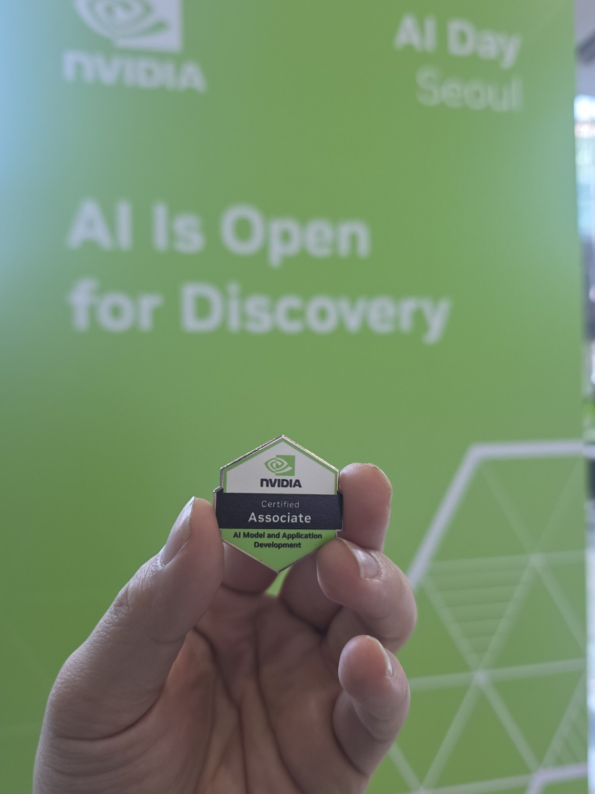
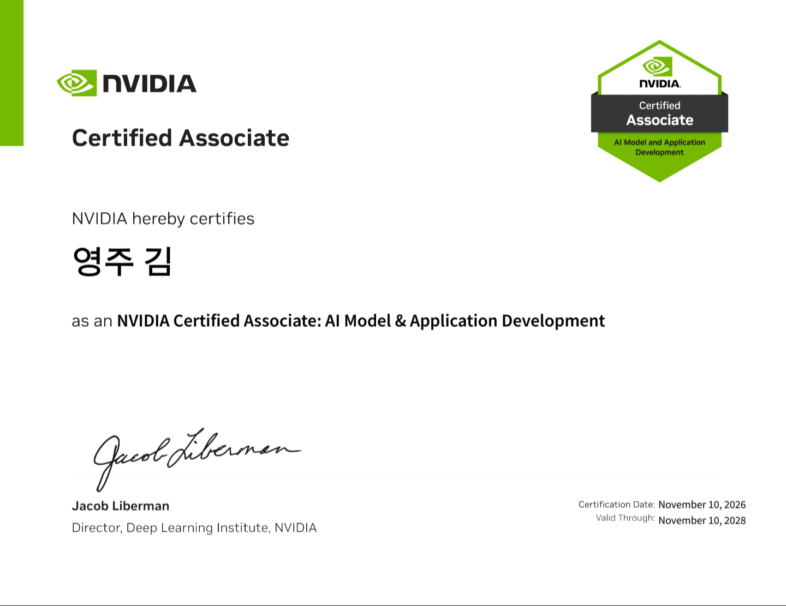

[NVIDIA NCA-AMAD 시리즈 전체 목차](/nca-amad/)

2026년 11월 10일, **NVIDIA Certified Associate: AI Model & Application Development(NCA-AMAD)** 자격을 취득했다.

처음 준비할 때는 AI와 Python의 기초는 알고 있었지만, 시험 유형과 공부 범위를 어떻게 잡아야 할지부터 확인해야 했다. 이번 글에는 시험의 개요, 응시 목적, 준비 과정과 취득 소감을 남긴다. 공부한 기술 내용은 별도로 1장부터 8장까지 나누어 정리했다.

<figure class="study-capture study-capture--portrait">
  
  <figcaption>NVIDIA AI Day Seoul에서 남긴 자격 배지 사진.</figcaption>
</figure>

## 어떤 시험인가

NCA-AMAD는 NVIDIA 플랫폼에서 AI 모델과 애플리케이션을 개발하고, 맞춤화하고, 배포하는 데 필요한 기초 역량을 확인하는 Associate 등급 자격증이다. 모델 선택만이 아니라 데이터·검색 파이프라인, 추론 최적화, 에이전트, 배포와 운영까지 AI 애플리케이션의 흐름을 함께 다룬다.

[NVIDIA 공식 시험 안내](https://www.nvidia.com/en-us/learn/certification/ai-model-application-development-associate/)에서 확인한 기본 정보는 다음과 같다. 아래는 2026년 11월 10일 기준의 공식 안내이며, 내가 응시한 시험의 개별 문항이나 점수 기록은 아니다.

| 항목 | 공식 안내 |
| --- | --- |
| 자격 등급 | Associate |
| 시험 시간 | 60분 |
| 문항 | 객관식 50~60문항 |
| 실습 시험 | 없음 |
| 결과 | Pass / Fail |
| 유효기간 | 발급일부터 2년 |

실습 시험이 없다는 것은 이 자격증만으로 실제 서비스를 구현·운영한 경험까지 입증되는 것은 아니라는 뜻이기도 하다. 내게는 관련 개념을 체계적으로 점검하는 기준으로 의미가 있었다. 실제 응시 조건과 운영 정책은 예약 시점의 공식 안내를 확인해야 한다.

## 왜 준비했나

레이더 알고리즘을 개발해 온 입장에서, AI를 공부할 때도 모델 하나의 성능만큼 데이터와 평가 조건, 실행 환경이 중요하다고 생각한다. 앞으로 AI·ML 개발 역량을 넓히려면 개별 기술을 따로 아는 데서 나아가, 모델이 애플리케이션 안에서 어떻게 사용되는지 이해할 필요가 있었다.

이번 준비의 목적도 그 연결을 정리하는 데 있었다. 답변 품질이 낮을 때 Prompt를 바꿔야 하는지, 검색을 고쳐야 하는지, Fine-tuning이 필요한지를 구분하고 싶었다. 모델 실행이 느릴 때도 GPU 수부터 늘리기보다 입력 처리, 토큰 생성, 요청 대기 중 어디가 병목인지 설명할 수 있는 기준이 필요했다.

NCA-AMAD의 범위는 이런 질문들을 데이터, 모델, 추론, 배포와 운영이라는 큰 흐름 안에서 다시 살펴보는 출발점이 되었다.

## 어떻게 준비했나

### 범위를 먼저 나누었다

2026년 10월 29일 시험 준비를 시작하면서 하루 1시간 이상 공부하는 것을 목표로 세웠다. 먼저 공식 출제 영역을 확인하고, 이미 알고 있는 용어와 별도로 공부해야 하는 개념을 나누었다.

제품 이름보다 각 영역이 답하는 질문을 중심으로 정리했다. Agentic AI는 무엇을 실행하는지, Data Flywheel은 무엇을 개선하는지, Inference는 무엇을 측정하는지처럼 역할과 판단 기준을 연결했다.

### 비슷한 용어를 비교하며 공부했다

개념 설명과 한국어 기초·응용 문제를 요청하면서, 주요 기술용어는 영어 이름도 함께 정리했다. 같은 뜻처럼 보이지만 실제로는 다른 축을 설명하는 용어들을 비교했다.

- Workflow와 Agent는 실행 순서를 누가 결정하는지에서 차이가 있다.
- Prompt, RAG, Fine-tuning은 각각 지시, 외부 근거, 학습 파라미터를 바꾼다.
- SFT는 학습 목표에 관한 개념이고, LoRA는 파라미터를 효율적으로 학습하는 방식이다. 둘은 함께 사용할 수 있다.
- TTFT, 토큰당 생성시간, 시스템 전체 처리량은 서로 다른 지표다.
- Replica를 늘리는 것과 한 모델을 Tensor Parallelism으로 나누는 것은 같은 일이 아니다.

계산도 단위와 가정을 붙여 정리했다. 가중치 메모리 계산에 KV cache와 실행 버퍼가 빠져 있다는 점, 전체 응답시간 계산에서 첫 토큰이 TTFT에 이미 포함된다는 점처럼 숫자보다 식의 적용 조건을 확인했다.

### 마지막에는 새로운 범위보다 판단 기준을 복습했다

마지막에는 공식 예제로 최종 평가를 요청했고, 시험 1시간 전에는 전체 범위를 다시 볼 수 있는 핵심 정리북을 요청해 준비했다. 정리북에는 용어뿐 아니라 상황에서 요구하는 목적과 제약을 구분하는 기준을 담았다.

예를 들어 최신 문서가 답변에 반영되지 않는 문제와, 정답 문서는 제공했지만 출력 형식이 흔들리는 문제는 다르게 접근해야 한다. 또 최대 처리량이 높은 구성이라도 목표 지연시간을 넘으면 서비스 요구사항을 만족했다고 볼 수 없다.

공개된 예제를 포함해 시험 문항 자체는 이 블로그에 옮기지 않았다. 아래 학습 노트에는 공부한 개념과 설명을 위한 계산·적용 사례만 남겼다.

## 자격증 취득 기록

| 항목 | 내용 |
| --- | --- |
| 자격 | NVIDIA Certified Associate: AI Model & Application Development |
| 약칭 | NCA-AMAD |
| 취득일 | 2026년 11월 10일 |
| 인증서상 유효기간 | 2028년 11월 10일까지 |

## 1장부터 8장까지의 학습 노트

공부한 내용은 아래 순서로 정리했다. 비중은 공식 시험 안내를 따르고, 장 번호는 개인 학습 목차에 맞췄다. 비중이 실제 시험의 고정 문항 수를 뜻하는 것은 아니다.

| 장 | 학습 주제 | 비중 |
| --- | --- | --- |
| [1장](/nca-amad/chapter-01-agentic-ai/) | Agentic AI | 17% |
| [2장](/nca-amad/chapter-02-data-flywheel/) | Data Processing and Data Flywheel | 17% |
| [3장](/nca-amad/chapter-03-inference/) | Inference Concepts | 15% |
| [4장](/nca-amad/chapter-04-customization/) | Model Customization and Fine-Tuning | 14% |
| [5장](/nca-amad/chapter-05-model-types/) | Models and Model Types | 11% |
| [6장](/nca-amad/chapter-06-enterprise-blueprints/) | NVIDIA AI Enterprise and Blueprints | 10% |
| [7장](/nca-amad/chapter-07-sizing-configuration/) | Sizing and Configuration | 10% |
| [8장](/nca-amad/chapter-08-physical-ai/) | Physical AI | 6% |

## 취득 소감과 앞으로 남겨 둘 기준

합격은 반가운 결과다. 다만 이번 공부에서 더 오래 남기고 싶은 것은 모델 이름이나 시험 문항보다, AI 애플리케이션의 문제를 나누어 보는 기준이다. 특히 다음 세 가지를 다시 확인할 수 있게 되었다.

첫째, **무엇이 문제인지 먼저 나누었는가?** 답변이 틀렸다는 이유만으로 Fine-tuning부터 시작할 수는 없다. 검색된 근거가 부족한지, 질문의 의도를 잘못 해석했는지, 출력 형식이 불안정한지부터 구분해야 한다.

둘째, **어떤 조건에서 성능을 비교했는가?** 모델이나 GPU의 이름만으로 속도를 비교하면 입력 길이, 출력 길이, 동시 요청 수, 정밀도가 빠지기 쉽다. 조건을 기록해야 결과를 해석할 수 있다.

셋째, **배포 후에도 확인할 수 있는가?** 서버가 정상 응답한다고 모델의 답변까지 정확한 것은 아니다. 로그와 지연시간뿐 아니라 근거 충실도, 업무 성공률, 버전별 변화도 살펴봐야 한다.

자격증 취득은 이번 공부의 한 기록으로 남기고, 정리한 개념은 작은 구현과 검증으로 이어 가려고 한다. 알고 있는 용어를 늘리는 데서 끝내지 않고, 어떤 선택을 했고 왜 그렇게 판단했는지 설명할 수 있도록 공부를 계속할 생각이다. 이 시리즈도 그때 다시 꺼내 볼 수 있는 기준이 되었으면 한다.

## 참고 자료

- [NVIDIA NCA-AMAD 공식 시험 안내와 학습 범위](https://www.nvidia.com/en-us/learn/certification/ai-model-application-development-associate/)
- [NVIDIA Certification](https://www.nvidia.com/en-us/learn/certification/)

---

[1장. Agentic AI부터 읽기 →](/nca-amad/chapter-01-agentic-ai/)
