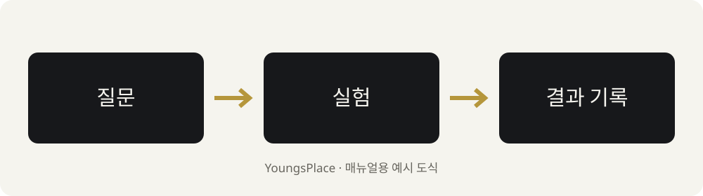
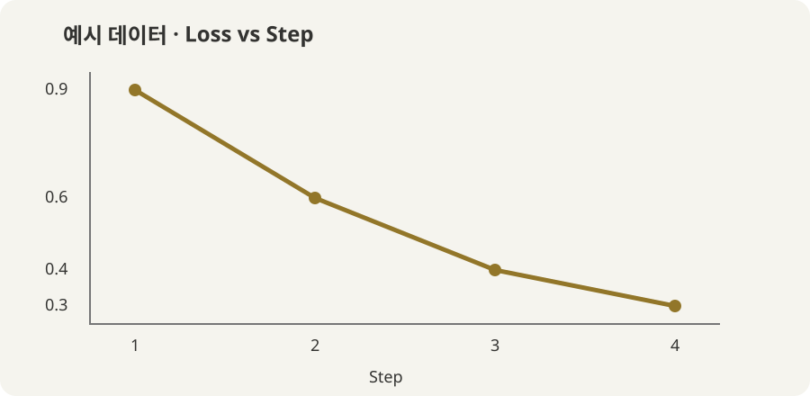

이 블로그는 **글 파일과 사진을 GitHub에 저장하면 웹사이트가 만들어지는 방식**이다. 글은 Markdown으로 쓰고, 그림·코드·수식·그래프를 필요한 자리에 섞어 넣으면 된다.

처음부터 전부 읽을 필요는 없다. 새 글을 쓸 때는 1–4번, 사진을 넣을 때는 6–8번처럼 필요한 부분을 골라 보자. 이 안내의 예시 자료는 실제 공부 결과가 아닌 기능 설명용이다.

## 먼저 고르기: 지금 무엇을 하고 싶은가?

| 하고 싶은 일 | 이 안내에서 볼 부분 |
| --- | --- |
| 처음으로 글 한 편 만들기 | 1–3. 폴더와 새 글 만들기 |
| 남에게 안 보이게 쓰고 싶기 | 4. 초안과 비공개의 차이 |
| 글 수정·공개·게시 확인 | 5. 수정과 게시 확인 |
| 사진·스크린샷·직접 그린 그림 넣기 | 6–7. 이미지와 캡션 |
| 사진을 나란히, 대표 사진 넣기 | 8. 갤러리와 표지 |
| 제목·강조·목록·링크·접는 글 쓰기 | 9. 본문 서식 |
| 코드·터미널 결과·오류 기록 | 10. 코드와 로그 |
| 논문 수식·표·각주 넣기 | 11–12. 수식과 표 |
| 그래프·순서도 넣기 | 13–14. 그래프와 Mermaid |
| 영상·PDF·다운로드 파일 넣기 | 15. 영상과 첨부 |
| 스터디·논문·실험 글의 틀이 필요하기 | 16. 복사용 틀 |
| Mac에서 완성 화면을 보며 쓰기 | 17. 로컬 미리보기 |
| 사진이나 글이 안 보이기 | 18. 문제 해결 |
| 다음부터 나에게 작업을 부탁하기 | 19. 요청 예시 |

## 1. 글 한 편은 폴더 하나로 묶는다

**한 글의 `index.md`와 그 글에서 쓸 자료를 같은 폴더에 모으는 방식**이 가장 관리하기 편하다.

```text
content/
└── local-ai-models-on-a-mac/
    └── week-02/
        ├── index.md           ← 글 본문
        ├── feature.jpg        ← 대표 사진: 선택 사항
        ├── terminal.png       ← 본문 스크린샷
        ├── architecture.svg   ← 직접 그린 구성도
        ├── loss.png           ← 그래프 이미지
        └── notes.pdf          ← 공개할 첨부 파일
```

사진을 전부 미리 넣을 필요는 없다. 글을 쓰다가 같은 폴더에 추가해도 된다.

### 어떤 폴더에 글을 만들까?

| 현재 메뉴 | GitHub에서 들어갈 폴더 |
| --- | --- |
| Local AI Models on a Mac | `content/local-ai-models-on-a-mac` |
| 공부 노트 | `content/notes` |
| 논문 리뷰 | `content/papers` |
| 사진 기록 | `content/journal` |
| 서재 | `content/books` |

폴더 이름은 **영문 소문자·숫자·하이픈**으로 정하면 주소와 파일 연결을 다루기 편하다. 제목은 한글로 자유롭게 써도 된다.

예를 들어 `content/local-ai-models-on-a-mac/week-02/index.md`는 게시 후 `/local-ai-models-on-a-mac/week-02/` 주소가 된다. 글의 주소를 유지하려면 공개 후 폴더 이름을 바꾸지 않는 편이 좋다.

## 2. GitHub 화면에서 새 글 만들기

1. [YoungsPlace 저장소](https://github.com/YoungsPlace/youngsplace.github.io)를 연다. 로그인 계정이 맞는지 확인한다.
2. `content` → 글을 넣을 폴더로 들어간다. 스터디 글이면 `local-ai-models-on-a-mac`이다.
3. **Add file → Create new file**을 누른다.
4. 파일 이름에 `week-02/index.md`처럼 입력한다. 이미 해당 메뉴 폴더에 들어왔다면 `content/...`를 또 붙이지 않는다.
5. 아래 기본 양식을 붙여 넣고 제목과 본문을 고친다.
6. **Commit changes... → Commit changes**로 저장한다. 여기서 Commit은 변경 내용을 GitHub에 저장하는 동작이다.

```yaml
---
title: "[2주차] 오늘 공부한 제목"
date: 2026-10-25
draft: true
summary: "무엇을 공부했고 어떤 내용을 다루는지 한두 문장."
tags: ["로컬 AI", "Mac"]
series: ["Local AI Models on a Mac"]
math: false
---

## 이번에 공부한 것

여기부터 본문을 쓴다.

## 직접 해본 것

명령어와 결과를 나눠 적는다.

## 배운 점과 다음 질문

아직 이해가 덜 된 것도 남긴다.
```

**이 예시의 `draft: true`는 블로그 화면에 글을 내보내지 않는 설정**이다. 저장소 원본까지 비공개로 만드는 기능은 아니다. 다음 4번을 먼저 읽고 보관 방식을 고르자.

## 3. 글 맨 위 설정은 무엇을 뜻할까?

맨 위 `---` 두 줄 사이가 글의 설정이고, 그 아래가 본문이다. 설정 이름 뒤의 `:`와 들여쓰기를 유지한다.

| 설정 | 용도 | 예시·주의점 |
| --- | --- | --- |
| `title` | 화면에 보이는 제목 | 특수문자가 있어도 편하게 쓰도록 큰따옴표로 감싸기 |
| `date` | 글의 날짜 | `2026-10-25`처럼 쓰기. 미래 날짜는 기본 게시에서 제외됨 |
| `lastmod` | 나중에 수정한 날짜 | 크게 고쳤다면 추가 가능 |
| `draft` | 게시 제외 여부 | `true`: 제외, `false`: 게시 대상 |
| `summary` | 글 목록 카드의 소개 | 제목을 반복하기보다 내용 한두 문장 |
| `tags` | 검색·분류용 꼬리표 | `["Ollama", "실험"]` |
| `series` | 연재 글 묶기 | 같은 연재에서는 이름을 정확히 동일하게 쓰기 |
| `math` | 수식 표시 기능 | 수식을 쓰는 글은 `true` |
| `showTableOfContents` | 목차 표시 | 긴 글은 `true`, 짧은 메모는 `false` |
| `showHero` | 본문 위 대표 이미지 | `false`면 본문 위 큰 표지를 숨김 |
| `showDateUpdated` | 수정일 표시 | `lastmod`와 함께 `true`로 사용 가능 |

**메뉴 폴더와 태그는 다르다.** 글을 `papers` 폴더에 넣으면 논문 리뷰 메뉴에 들어가고, `tags`는 그 글을 다른 관점으로 묶어 준다. 새 태그를 만들었다고 상단 메뉴가 자동으로 생기지는 않는다.

날짜와 불리언 값은 예시처럼 쓰고, `true`·`false`는 소문자로 쓴다. 제목에 큰따옴표 자체를 넣고 싶으면 `title: '"작은 모델"을 실행해 보기'`처럼 바깥을 작은따옴표로 감싸도 된다.

## 4. 초안과 비공개는 다르다

### 나만 보는 초안이 필요할 때

**Mac의 파일로만 저장하고 GitHub에 올리지 않는다.** 이 저장소는 공개 상태이므로 GitHub에 저장한 글 원본과 첨부 파일은 다른 사람도 볼 수 있다.

로컬에서 `draft: true`로 두고 쓰다가, 공개할 준비가 됐을 때 파일과 자료를 올리면 된다.

### 본문은 공개돼도 되지만 블로그 목록에는 아직 안 올릴 때

GitHub에 `draft: true`로 저장할 수 있다. 정식 블로그 빌드에서는 페이지·목록·검색에서 제외되지만, **GitHub 원본은 공개**다.

### 공개할 준비가 됐을 때

1. 본문과 사진을 확인한다.
2. `draft: false`로 바꾼다.
3. 날짜가 미래가 아닌지 확인한다.
4. Commit changes로 저장한다.
5. 게시 작업이 끝나면 실제 블로그 주소를 연다.

### 이미 올린 글을 블로그에서 숨기고 싶을 때

`draft: true`로 바꾸고 저장한다. 새 게시가 끝나면 블로그에서 빠진다. 다만 이미 공개된 원본·Git 기록·검색 결과까지 지워지는 것은 아니다. **다시 숨길 수도 있다는 생각으로 민감한 내용을 올리지 않는다.**

## 5. 기존 글 수정과 게시 확인

### 글을 고칠 때

1. GitHub에서 해당 글의 `index.md`를 연다.
2. **Edit this file** 또는 연필 버튼을 누른다.
3. 내용을 고치고 Commit changes로 저장한다.
4. [Actions](https://github.com/YoungsPlace/youngsplace.github.io/actions)에서 가장 최근 **Publish blog** 작업을 확인한다.
5. 초록 체크가 나오면 실제 블로그에서 새로고침한다. 대기·진행 중이면 게시가 아직 끝나지 않은 상태다.

GitHub 편집기의 **Preview는 기본 Markdown 미리보기**다. 이 블로그의 수식·그래프·특수 이미지 배치는 실제 사이트나 로컬 미리보기에서 확인한다.

### 제목만 바꿀 때와 주소까지 바꿀 때

- `title`만 바꾸면 폴더가 같으므로 글 주소는 유지된다.
- `week-02` 같은 폴더 이름이나 `slug`를 바꾸면 주소가 달라질 수 있다.
- 이미 공유한 글은 제목부터 고치고, 폴더는 가능한 한 유지하는 편이 관리하기 쉽다.

### 설정 파일은 어디까지 만질까?

본문은 `content`, 상단 메뉴는 `config/_default/menus.ko.toml`에서 바꾼다. 단순 글쓰기에는 `.github/workflows`, `layouts`, `themes`를 고칠 필요가 없다. 새 메뉴가 필요하면 19번 예시처럼 요청해도 된다.

## 6. 사진·스크린샷·그림 한 장 넣기

### GitHub에 사진 올리기

1. 해당 글의 `index.md`가 있는 폴더를 연다.
2. **Add file → Upload files → Choose your files**를 선택한다.
3. JPG·PNG·WebP·SVG 등의 파일을 고른다.
4. 업로드 목록이 모두 나타나면 Commit changes로 저장한다.
5. `index.md`를 수정해 아래 문법을 원하는 위치에 넣는다.

```markdown

```

이 예시는 **같은 폴더의 `terminal.png`**를 가리킨다. `![ ]` 안에는 사진 내용을 설명하는 문장을 넣는다. 사진이 보이지 않을 때와 화면 읽기 도구에서도 쓰인다.

`/Users/이름/Desktop/terminal.png` 같은 내 컴퓨터 경로는 웹사이트에서 열 수 없다. 클립보드에 복사한 것만으로도 파일이 올라가지 않는다. GitHub의 이슈·댓글 입력창에 사진을 붙이는 것과 블로그 폴더에 파일을 올리는 것도 서로 다른 작업이다.

### 사진이 여러 폴더로 나뉠 때

```text
week-02/
├── index.md
└── images/
    └── terminal.png
```

```markdown

```

`images`는 선택 사항이다. 처음에는 한 폴더에 모아도 충분하다.

### 어떤 파일 형식을 쓰면 좋을까?

| 자료 | 보관 방식 예시 |
| --- | --- |
| 일반 사진 | JPG 또는 WebP |
| 글씨가 많은 화면·투명 이미지 | PNG |
| 직접 그린 도식·벡터 그래프 | SVG |
| 움직이는 짧은 설명 | GIF 또는 짧은 MP4 |
| 차트·논문 결과 그림 | PNG·SVG. 글씨가 읽히는지 확인 |

Mac의 **Shift + Command + 4**로 영역을 캡처한 뒤 파일 이름을 정해 올릴 수 있다. Keynote·그림 도구에서 만든 그림이나 AI로 만든 이미지도 파일로 내보내면 같은 방식으로 넣는다. 이 블로그가 자동으로 그림을 생성하거나 Python 코드를 실행하는 것은 아니다.

파일 이름은 `experiment-01.png`처럼 간단히 정한다. 업로드 이름과 본문 이름의 **확장자·대소문자**를 맞춘다. `result.png`와 `Result.PNG`는 다르게 취급될 수 있다.

브라우저 업로드는 현재 파일당 25 MiB 제한이 있다. 실무적으로 사진 한 장은 가능하면 몇 MB 이내로 줄이면 읽는 사람이 빠르게 열 수 있다. [GitHub 업로드 제한](https://docs.github.com/en/repositories/working-with-files/managing-files/adding-a-file-to-a-repository)

## 7. 사진 설명·크기·정렬 바꾸기

### 사진 아래 설명을 붙일 때

이 블로그에서는 Markdown 이미지 뒤의 따옴표를 캡션으로 표시한다.

```markdown

```

아래가 실제 표시 예시다.


### 캡션에 출처 링크를 넣을 때

```markdown


*그림 1. 논문 구조를 설명한 그림. 출처: [논문 원문](https://example.com/paper)*
```

설명을 별도 문단으로 적는 방식도 간단하다. 다른 자료를 넣을 때는 출처 링크와 직접 다시 그린 것인지 여부를 함께 남긴다.

### 이미지 폭을 줄이고 가운데 놓을 때

```html

```

`560px`을 바꾸면 폭이 달라진다. `max-width:100%`는 작은 화면에서 넘치지 않게 한다. 이 HTML 방식은 Markdown 이미지의 자동 크기 최적화와 확대 동작이 똑같이 적용되지는 않는다. 기본적으로는 Markdown을 쓰고, 크기 조절이 꼭 필요할 때 선택하면 된다.

### 그림과 캡션을 한 묶음으로 넣을 때

아래는 이 테마가 제공하는 `figure` 문법이다. 중괄호까지 그대로 복사하고 파일 이름과 설명만 바꾼다.

```text

```

## 8. 여러 사진 나란히, 갤러리, 대표 사진

### 두 장을 항상 두 칸으로 놓을 때

```html
<div style="display:grid; grid-template-columns:repeat(2,minmax(0,1fr)); gap:12px;">
  <figure style="margin:0;">
    
    <figcaption>변경 전</figcaption>
  </figure>
  <figure style="margin:0;">
    
    <figcaption>변경 후</figcaption>
  </figure>
</div>
```

사진 속 글씨가 많다면 모바일의 두 칸 배치가 작게 보일 수 있다. 이럴 때는 기본 Markdown으로 한 장씩 놓는 편이 낫다.

### 사진 수가 많아 갤러리로 보여줄 때

```text




```

사진을 같은 글 폴더에 올리고 파일 이름을 맞춘다. 일반 Markdown 사진 세 장은 세로로 쌓이고, 위 `gallery`는 여러 사진을 갤러리로 배치한다.

실제 갤러리 배치 예시다. 아래 두 장은 매뉴얼을 위해 만든 도식이다.






### 글 목록에 대표 사진을 넣을 때

같은 폴더에 `feature.jpg` 또는 `feature.png`처럼 **`feature`로 시작하는 이미지 한 장**을 둔다. 현재 테마가 대표 이미지로 찾는다.

대표 이미지는 카드와 본문 위 표지에 사용될 수 있다. 본문 위 큰 표지만 숨기고 싶으면 글 설정에 다음을 추가한다.

```yaml
showHero: false
```

대표 사진과 같은 사진을 본문에도 다시 넣으면 두 번 보일 수 있다. 실제 화면을 보고 한쪽을 빼면 된다. 대표 이미지는 한 글에 여러 장 두지 않는 편이 명확하다.

## 9. 제목·문단·강조·링크·목록·접는 글

### 제목과 문단

글의 큰 제목은 맨 위 `title`이 담당한다. 본문은 보통 `##`부터 시작한다.

```markdown
## 큰 항목

본문 문장. 문단 사이에는 빈 줄을 넣는다.

### 작은 항목

다른 문단.
```

그냥 Enter 한 번은 문단을 나누지 않을 수 있다. 기본적으로 **빈 줄 하나를 넣으면 새 문단**이다. 꼭 줄만 바꾸려면 문장 끝에 공백 두 개를 넣거나 `<br>`를 쓴다.

### 강조와 링크

```markdown
**중요한 내용**

*그림 설명이나 짧은 메모*

`명령어 또는 파일 이름`

[참고 문서](https://example.com)

[내 스터디 목록](/local-ai-models-on-a-mac/)
```

강조 표시가 그대로 보이면 별표 양옆을 확인한다. 특히 괄호와 한글 조사가 붙을 때는 `**학습**과 **추론**`처럼 표시 범위를 단순하게 쓰면 편하다.

### 목록과 할 일

```markdown
- 읽은 것
- 이해한 것
- 다음 질문

1. 설치한다.
2. 실행한다.
3. 결과를 기록한다.

- [x] 자료 읽기
- [ ] 직접 실행하기
- [ ] 결과 화면 넣기
```

체크박스 상태를 저장하려면 글 파일의 `[ ]`를 `[x]`로 고친다. 웹 화면의 체크박스를 눌러도 GitHub 원본이 자동 수정되지는 않는다.

### 인용과 메모

```markdown
> 원문에서 가져온 짧은 문장.
>
> 출처: 문서 제목과 링크
```

인용과 내가 해석한 내용은 문단을 나눠 적는다. 긴 원문 전체를 붙이기보다 필요한 부분을 짧게 인용하고 원문을 연결한다.

### 긴 설명을 접어두기

```html
<details>
<summary>오류 메시지 전체 보기</summary>

여기에 긴 설명이나 코드 블록을 넣는다.

</details>
```

`summary` 다음과 닫는 태그 앞에 빈 줄을 둔다. 다음은 실제 예시다.

<details>
<summary>눌러서 글쓰기 팁 보기</summary>

긴 설치 로그는 접고, 본문에는 **오류 원인과 해결 방법**부터 적으면 읽기 편하다.

</details>

## 10. 코드·터미널 명령어·오류 로그

### 코드 블록 넣기

백틱 세 개 다음에 언어 이름을 붙이고, 끝에서도 백틱 세 개로 닫는다.

````markdown
```python
message = "Hello, local AI!"
print(message)
```
````

주로 쓰는 이름은 `python`, `sh`, `json`, `yaml`, `text`다. 실행 결과와 오류는 `text`로 넣으면 된다. 복사 버튼도 코드 블록에 표시된다.

### 명령어와 결과를 나눠 적기

````markdown
실행한 명령어:

```sh
ollama list
```

실제 결과:

```text
여기에 내 터미널의 실제 출력을 붙인다.
```
````

성공한 것처럼 예시 출력을 적지 말고, 예시라면 예시라고 표시한다. 이 블로그의 코드 블록은 **보여주는 기능**이다. Python 코드가 블로그 안에서 자동 실행되지는 않는다.

### 일부 줄을 강조할 때

````markdown
```python {linenos=true,hl_lines=[2]}
model = "gemma3:4b"
print(model)
```
````

`linenos=true`는 줄 번호, `hl_lines=[2]`는 두 번째 줄 강조다.

### 오류 해결 글의 기본 순서

**상황 → 실행 명령 → 오류 원문 → 원인 → 바꾼 것 → 재실행 결과** 순서가 좋다. 긴 오류 로그는 9번의 접는 영역에 넣으면 된다.

## 11. 논문 수식 넣기

글 맨 위 설정에 `math: true`를 넣는다. 현재 블로그는 이 값을 켜면 KaTeX를 불러오도록 설정되어 있다.

### 문장 안의 짧은 수식

```text
오차는 \(y - \hat{y}\)로 표현한다.
```

실제 표시: 오차는 \(y - \hat{y}\)로 표현한다.

이 블로그에서 인라인 수식은 `\(`와 `\)`를 쓰는 방식으로 안내한다. 달러 기호 하나로 감싸는 방식과 섞지 않는 편이 편하다.

### 별도 줄의 큰 수식

```text
$$
L = \frac{1}{n}\sum_{i=1}^{n}(y_i-\hat{y}_i)^2
$$
```

실제 표시:

$$
L = \frac{1}{n}\sum_{i=1}^{n}(y_i-\hat{y}_i)^2
$$

수식이 그대로 글자로 보이면 `math: true`, 시작·끝 구분자, 역슬래시를 확인한다. Markdown 코드 블록 안에 넣은 수식은 계산식이 아니라 문법 예시로 표시되는 것이 정상이다.

## 12. 표·각주·논문 정보

### 간단한 비교표

```markdown
| 항목 | 모델 A | 모델 B |
| --- | --- | --- |
| 파라미터 | 실제 값 | 실제 값 |
| 실행 환경 | 내 환경 | 내 환경 |
| 관찰 결과 | 측정 후 기록 | 측정 후 기록 |
```

복잡하고 가로로 긴 표는 모바일에서 읽기 어렵다. 핵심 열만 본문에 남기고 전체 데이터는 CSV 파일이나 원문 링크로 연결해도 된다. 표 셀 안 줄바꿈은 `<br>`를 쓸 수 있다. 셀 안에서 `|` 자체를 쓰려면 `\|`처럼 적는다.

### 각주

```markdown
이 부분은 추가 설명이 필요하다.[^memo]

[^memo]: 추가 설명과 참고 링크.
```

실제 예시: 숫자와 조건을 함께 남겨야 실험을 다시 비교할 수 있다.[^conditions]

[^conditions]: 같은 모델 이름이어도 태그·실행 버전·입력·설정이 다르면 결과가 달라질 수 있다. 이 각주는 문법 설명용이다.

### 논문 리뷰에서 남기면 좋은 정보

제목, 저자, 발표 연도, 원문·코드 링크, 해결하려는 문제, 핵심 아이디어, 실험 조건, 한계, 내 생각을 나눠 쓴다. 표나 그림을 가져오면 논문 내 번호와 출처를 남기고, 직접 다시 그렸다면 그렇게 적는다.

## 13. 그래프 넣기: 이미지와 인터랙티브 차트

### 경우 A. Python이나 스프레드시트에서 만든 그래프

그래프를 PNG·SVG로 저장하고 사진처럼 넣는 방식이 가장 간단하다.

````markdown
```python
import matplotlib.pyplot as plt

steps = [1, 2, 3, 4]
loss = [0.9, 0.6, 0.4, 0.3]  # 문법 설명용 예시 데이터
plt.plot(steps, loss, marker="o")
plt.xlabel("Step")
plt.ylabel("Loss")
plt.savefig("loss.png", dpi=180, bbox_inches="tight")
```


````

**위 Python 코드는 내 컴퓨터에서 실행해서 `loss.png`를 만든 뒤 업로드**해야 한다. 코드를 글에 붙이는 것만으로 이미지가 만들어지지는 않는다.

축 이름·단위·범례를 넣고, 다크 모드에서도 글씨가 읽히는지 확인한다. 아래는 실제 측정값이 아닌 예시 그래프 이미지다.


### 경우 B. 마우스를 올리면 값이 나오는 차트

작은 데이터는 Chart.js 차트 문법으로 본문에 직접 넣을 수 있다.

```text

type: 'line',
data: {
  labels: ['1', '2', '3', '4'],
  datasets: [{
    label: '예시 loss',
    data: [0.9, 0.6, 0.4, 0.3],
    borderColor: '#c9ae55',
    backgroundColor: '#c9ae55',
    tension: 0.2
  }]
},
options: {
  responsive: true,
  scales: {
    x: { title: { display: true, text: 'Step' } },
    y: { title: { display: true, text: 'Loss' } }
  }
}

```

실제 표시 예시:


type: 'line',
data: {
  labels: ['1', '2', '3', '4'],
  datasets: [{
    label: '예시 loss',
    data: [0.9, 0.6, 0.4, 0.3],
    borderColor: '#c9ae55',
    backgroundColor: '#c9ae55',
    tension: 0.2
  }]
},
options: {
  responsive: true,
  scales: {
    x: { title: { display: true, text: 'Step' } },
    y: { title: { display: true, text: 'Loss' } }
  }
}


`labels`와 `data`의 개수를 맞춘다. `type: 'bar'`로 바꾸면 막대 차트를 만들 수 있다. 데이터를 고칠 때 쉼표와 괄호를 빠뜨리면 차트가 보이지 않을 수 있다.

### 경우 C. Plotly처럼 이미 만든 HTML 그래프

다른 방식으로는 **자립적으로 열리는 HTML 그래프 파일**을 같은 폴더에 올리고 연결할 수 있다.

```markdown
[인터랙티브 그래프 새 창으로 보기](plot.html)
```

본문 안에 보이게 하려면 다음처럼 넣는다.

```html
<iframe src="plot.html" title="모델 비교 그래프"
        style="width:100%; height:520px; border:0;"
        loading="lazy"></iframe>
```

HTML 파일이 외부 서비스나 별도 파일을 필요로 한다면 그것도 함께 준비해야 한다. 비공개 분석 파일이나 믿을 수 없는 외부 HTML을 그대로 올리지 않는다. 처음에는 그래프 이미지, 필요할 때 Chart.js나 별도 HTML로 넓혀 가면 된다.

## 14. 흐름도·구조도 넣기

그림 도구로 그린 파일을 이미지로 넣어도 되고, Mermaid로 텍스트를 도식으로 바꿀 수도 있다. 이 블로그에서는 아래 전용 문법을 사용한다.

```text

flowchart LR
  A[질문] --> B[실험]
  B --> C[결과 기록]

```

실제 표시:


flowchart LR
  A[질문] --> B[실험]
  B --> C[결과 기록]


`LR`은 왼쪽에서 오른쪽, `TD`는 위에서 아래다. 긴 문구나 괄호가 들어가면 `A["긴 문구 (설명)"]`처럼 따옴표로 감쌀 수 있다. 복잡한 논문 도식은 직접 그린 SVG·PNG가 더 자유롭다.

## 15. 영상·PDF·첨부 파일

### 짧은 MP4를 본문에서 재생하기

글 폴더에 `demo.mp4`를 올리고 다음 문법을 넣는다.

```text

```

영상이 크면 저장소와 페이지 로딩 부담이 커진다. 긴 미팅 녹화는 영상 서비스에 보관하고 링크로 연결하는 방식이 더 편하다. 멤버 전용 자료는 접근 권한을 확인한 뒤 공개 가능한 범위만 정리한다.

### YouTube 연결

가장 간단한 방식은 링크다.

```markdown
[관련 영상 보기](https://www.youtube.com/watch?v=영상ID)
```

본문에 플레이어를 넣으려면 아래의 `실제영상ID`를 주소의 `v=` 뒤 값으로 바꾼다.

```text

```

### PDF·CSV·ZIP 다운로드 링크

글 폴더에 파일을 올린 뒤 연결한다.

```markdown
[내가 만든 정리 PDF](notes.pdf)

[실험 데이터 CSV](results.csv)

[실습 예제 ZIP](example.zip)
```

링크를 누르면 브라우저와 파일 종류에 따라 열리거나 다운로드된다. 원본 논문은 파일을 다시 올리기보다 논문 공식 페이지나 공개 원문 링크를 연결하는 방식도 좋다.

## 16. 바로 복사하는 글 틀

아래에서 필요한 틀 하나를 새 `index.md`에 복사한다. 날짜·제목·태그·본문을 고치고, 공개 전에는 4번 내용을 다시 확인한다.

### 스터디 주차별 기록

```markdown
---
title: "[2주차] 공부한 주제"
date: 2026-10-25
draft: true
summary: "이번 주 핵심과 직접 해본 내용을 한두 문장으로."
tags: ["로컬 AI", "실습"]
series: ["Local AI Models on a Mac"]
---

## 이번 주 범위

## 핵심 개념

## 실습 환경

## 실행한 명령어와 실제 결과

## 막힌 부분과 해결 과정

## 배운 점과 다음 질문

## 참고 자료
```

### 논문 리뷰

```markdown
---
title: "논문 제목: 내가 이해한 핵심"
date: 2026-10-25
draft: true
summary: "논문이 해결하려는 문제와 핵심 아이디어."
tags: ["논문 리뷰"]
math: true
---

## 논문 정보

- 제목:
- 저자 / 연도 / 발표처:
- 원문 / 코드:

## 한 문장 요약

## 문제와 기존 방법의 한계

## 핵심 아이디어와 방법

## 실험 조건과 결과

## 한계와 의문

## 내 생각 / 직접 해볼 것

## 참고 자료
```

### 실험·오류 해결 기록

```markdown
---
title: "문제 또는 실험 이름"
date: 2026-10-25
draft: true
summary: "어떤 상황에서 무엇을 확인했는지."
tags: ["실험", "문제 해결"]
---

## 목적 또는 증상

## 환경과 재현 조건

## 명령어 / 코드 / 오류 원문

## 시도한 방법

## 실제 결과

## 원인과 배운 점
```

### 사진 중심의 짧은 기록

```markdown
---
title: "사진으로 남기는 오늘의 기록"
date: 2026-10-25
draft: true
summary: "장면과 생각을 한두 문장으로."
tags: ["사진 기록"]
---


이 장면에서 관찰한 것과 떠오른 생각.

## 배운 것

## 다음에 살펴볼 것
```

### 서재에 독서 기록 남기기

상단 **서재** 메뉴에 쌓이는 독서 기록은 `content/books/책-이름/index.md`에 만든다. 책마다 폴더 하나를 만들고, 표지는 같은 폴더에 `feature.jpg`(또는 `feature.png`, `feature.webp`)로 올린다. 표지가 없으면 책 제목과 저자로 만든 책 모양이 대신 표시된다.

아래 양식에서 제목·저자·날짜·한 줄 감상을 바꾼다. `readingStatus`에는 `읽는 중`, `완독`, `다시 읽는 중`처럼 지금 상태를 적으면 된다. `draft: true`와 비공개의 차이는 4번을 확인한다. 게시할 때 `draft: false`로 바꾸면 서재에 날짜순으로 나타난다.

```markdown
---
title: "책장을 덮고 남은 생각"
date: 2026-10-25
draft: true
bookTitle: "책 제목"
bookAuthor: "저자 이름"
readingStatus: "완독"
description: "이 책이 나에게 남긴 것을 한 문장으로."
tags: ["독서"]
showHero: false
showTableOfContents: true
---

## 이 책을 펼친 이유

## 오래 남은 문장

> 짧은 인용문 — 저자, p.00

이 문장이 나에게 닿은 이유.

## 책장을 덮고 남은 생각

## 내 일상으로 가져갈 것
```

책 표지는 서재 카드에서 보이고 `showHero: false`이면 글 상단에는 크게 반복되지 않는다. 본문에도 넣고 싶으면 ``를 쓴다. 원문 인용은 필요한 짧은 부분에 출처와 페이지를 함께 남기고, 내 감상과 구분한다.

로컬에서 Hugo를 쓰는 경우 `hugo new content books/책-이름/index.md`로 준비된 독서 양식을 생성할 수 있다. `archetypes/books/index.md`가 그 원본이다.

## 17. Mac에서 완성 화면을 보며 쓰기

**GitHub 업로드 전부터 실제 테마 화면을 보려면 로컬 미리보기**를 쓴다. 아래 명령어의 `/path/to/study-blog`는 내 Mac에 저장한 블로그 폴더의 실제 경로로 바꾼다. Hugo 빌드 도구가 필요하다.

```sh
cd /path/to/study-blog
hugo server -D
```

터미널에 표시된 로컬 주소를 연다. 보통 `http://localhost:1313/`이며, 글 파일을 저장하면 화면도 갱신된다. `-D`는 로컬 미리보기에서 초안을 포함하는 옵션이다. 중지하려면 해당 터미널에서 `Ctrl+C`를 누른다.

현재 Hugo 실행 파일이 일반 명령어로 준비되어 있지 않다면 `hugo: command not found`가 나올 수 있다. 이 작업 폴더는 **Hugo Extended 0.167.0과 내려받은 Blowfish 테마**로 검증했다. [저장소 안내](https://github.com/YoungsPlace/youngsplace.github.io#readme)에 초기 준비 방법을 적어뒀고, 설정이 낯설다면 로컬 미리보기 준비를 요청해도 된다.

VS Code 같은 편집기에서는 폴더를 열고 `index.md`를 수정한 뒤 저장한다. Markdown 미리보기와 실제 Hugo 화면은 다를 수 있으니 최종 확인은 로컬 블로그에서 한다.

**로컬에서 저장한 것과 GitHub에 저장한 것은 별개다.** 로컬 파일을 고쳤다고 자동으로 GitHub에 올라가지는 않는다. 공개할 때는 확정한 글 폴더와 첨부 자료를 GitHub에 올린다. Git을 익혔다면 버전 관리로 동기화할 수 있지만, 아직 공개하지 않을 초안까지 한꺼번에 추가하지 않도록 파일 목록을 확인한다.

## 18. 자주 막히는 경우

| 상황 | 먼저 확인할 것 |
| --- | --- |
| 새 글이 안 보인다 | `draft: false`인지, 미래 날짜인지, 최근 Publish blog 작업이 성공했는지 |
| 사진 자리에 설명만 보인다 | 글과 같은 폴더에 올렸는지, 상대 경로·파일명·대소문자가 맞는지 |
| 스크린샷을 붙였는데 안 올라간다 | 파일로 저장한 뒤 해당 글 폴더의 Upload files로 올렸는지 |
| 수식이 문자 그대로 나온다 | `math: true`, 구분자와 역슬래시, 코드 블록 밖인지 |
| 그래프가 안 나온다 | shortcode 시작·종료, 쉼표·괄호, 데이터 개수를 확인 |
| 대표 사진이 두 번 나온다 | 표지와 본문에 같은 사진을 중복으로 넣었는지 |
| GitHub Preview에서 모양이 이상하다 | 실제 블로그·로컬 미리보기로 확인. GitHub는 테마 전용 기능을 모두 실행하지 않음 |
| 본문 일부가 전부 코드처럼 나온다 | 백틱 세 개로 연 코드 블록을 닫았는지 |
| 글이 옆 메뉴에 없다 | `content` 아래 올바른 메뉴 폴더에 넣었는지. `static`에 글을 넣지는 않았는지 |
| 제목을 바꿨더니 공유 주소가 안 열린다 | 제목 대신 폴더 이름이나 `slug`까지 바꾸지 않았는지 |
| 사진을 바꿨는데 예전 사진이다 | 게시 성공 후 새로고침. 새 파일 이름으로 교체하고 본문 경로도 함께 변경 가능 |
| 저장했는데 사이트 전체가 안 바뀐다 | Actions의 최신 실패 작업에서 build 단계 오류를 확인. 설정 문법이나 shortcode 오류일 수 있음 |

문제 해결을 요청할 때는 **해당 글 주소 또는 파일 위치 + 원하는 모습 + 현재 보이는 모습 + 오류 메시지**를 알려주면 빨리 확인할 수 있다.

## 19. 나에게 부탁할 때 쓸 수 있는 말

아래처럼 원하는 결과와 공개 여부를 함께 알려주면 된다.

> “Local AI Models on a Mac 2주차 글 초안을 만들어줘. 자료와 내 실행 결과는 이거야. 아직 게시하지 말고 채팅에서 먼저 보여줘.”

> “이 사진 세 장을 1주차 글의 실습 결과 아래에 넣어줘. 순서는 설치 화면 → 모델 목록 → 첫 대화야. 각각 설명도 붙이고, 아직 로컬 초안에만 반영해줘.”

> “이 논문 구조도를 내가 그린 그림으로 바꾸고 싶어. 설명할 요소는 A, B, C야. 먼저 그림을 보여줘.”

> “이 CSV로 그래프를 만들고 글에 넣어줘. X축은 모델, Y축은 응답 시간(초)이야. 예시 수치는 넣지 말고 실제 데이터만 써줘.”

> “이 초안에서 개인 정보와 출처를 확인하고, 내가 승인한 최종본만 블로그에 공개해줘.”

> “새 메뉴를 만들어줘. 이름은 독서 기록이고, 글쓰기 화면이 아니라 지금 블로그의 글 목록처럼 만들어줘.”

사진을 보낼 때는 어느 글의 어느 위치인지, 표지로도 쓸지 알려주면 좋다. 초안과 실제 경험을 구분할 수 있도록 **직접 실행한 결과인지, 자료에 나온 시연인지**도 함께 적어주면 된다.

## 공개 전 짧은 확인

- 제목·요약·날짜·태그가 맞는가?
- 내 경험과 자료 속 사례를 구분했는가?
- 사진·표·수식·코드가 실제 화면에서 읽히는가?
- 출처와 링크가 필요한 곳에 붙어 있는가?
- 계정 정보·API 키·미공개 자료가 들어가지 않았는가?
- 지금 이 글을 공개하려는 것이 맞는가?

## 더 찾아보기

- [GitHub에서 파일 업로드](https://docs.github.com/en/repositories/working-with-files/managing-files/adding-a-file-to-a-repository)
- [Hugo 글과 폴더 묶기](https://gohugo.io/content-management/page-bundles/)
- [Blowfish 이미지·그래프·영상 문법](https://blowfish.page/docs/shortcodes/)

이 안내는 현재 YoungsPlace 설정과 고정한 Blowfish 테마 버전에 맞춰 작성했다. 실제 화면과 함께 확인한 복사 예시를 기준으로 사용하면 된다.
