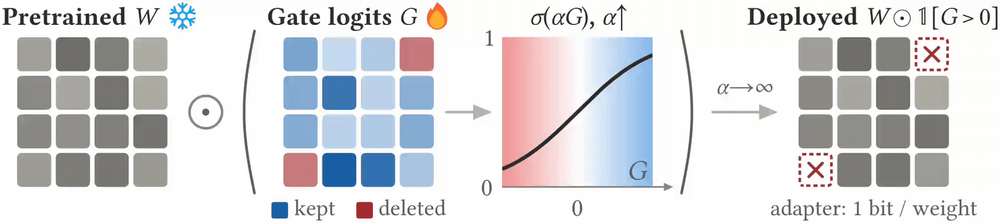
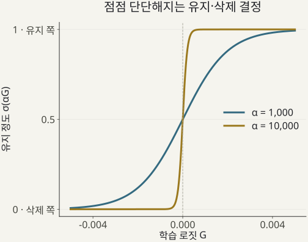
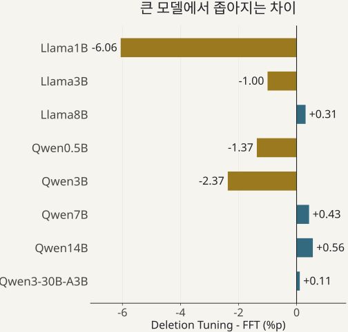

모델을 새 과업에 맞추려면 가중치에 새로운 숫자를 써야 할 것 같다. 어떤 연결을 더 강하게 만들고 다른 연결을 약하게 만드는 것이 학습이라는 설명에도 익숙하다. 그런데 이미 학습된 숫자는 그대로 두고, 일부를 **0으로 만드는 위치만 선택**해도 비슷한 성능을 얻을 수 있을까?

Jack Lu 외의 Deletion Tuning은 가중치를 0으로 만들 위치만 학습해 모델을 새 과업에 맞추는 방법이다. [논문 §1·§4](https://arxiv.org/html/2611.10866v1#S1)

Llama8B를 GSM8K에서 GRPO로 학습했을 때 Deletion Tuning은 83.55%, 전체 가중치를 학습한 FFT는 83.24%를 기록했다. 압축한 마스크는 8.4 MB였다. 실행할 때는 여기에 base 모델의 가중치가 필요하다. [논문 표 1](https://arxiv.org/html/2611.10866v1#S5.SS2)

연구진의 방법 설명 GIF

*연구진이 만든 원리 설명 애니메이션. 그림을 누르면 원본 크기로 볼 수 있다. [원본 GIF](https://github.com/agentic-learning-ai-lab/deleting-weights/blob/94f0340ebb574f95bb41d844165253a6785e215e/assets/method.gif) · [프로젝트](https://agenticlearning.ai/deleting-weights/) · [MIT License](https://github.com/agentic-learning-ai-lab/deleting-weights/blob/94f0340ebb574f95bb41d844165253a6785e215e/LICENSE)*

## 1. 논문 정보

| 항목 | 내용 |
|---|---|
| 현재 제목 | The Surprising Effectiveness of Deleting Weights in LLM Post-Training |
| 저자 | Jack Lu, Zhenbang Yang, Mike Lasby, Tejas Pote, Yani Ioannou, Mengye Ren |
| 소속 | New York University, University of Calgary. Lu·Yang 공동 1저자 |
| 읽은 판본 | arXiv:2611.10866v1, 2026년 11월 7일 제출 |
| 학회 | NeurIPS 2026 |
| 공식 목록의 이전 제목 | The Surprising Effectiveness of Deleting Weights in LLM Reasoning and Adaptation |

[arXiv](https://arxiv.org/abs/2611.10866)와 [프로젝트 페이지](https://agenticlearning.ai/deleting-weights/)는 현재 제목을, [NeurIPS 공식 목록](https://neurips.cc/Downloads/2026)과 [포스터](https://neurips.cc/virtual/2026/poster/154971)는 이전 제목을 사용한다. 여섯 저자는 같다.

아래 수치는 arXiv v1에 실린 결과를 인용했다. 별도의 모델 학습이나 재현 실험은 수행하지 않았다.

| 구분 | 내용 |
|---|---|
| 문제 | 새 과업 적응에 새로운 실수 가중치 값이 꼭 필요한가? |
| 아이디어 | gate projection의 가중치를 유지할지 지울지 학습한다. |
| 대표 결과 | 큰 모델의 GRPO·SFT·SDFT에서 FFT와 비슷한 정확도. GRPO Llama8B는 83.55% 대 83.24%. |
| 주요 한계 | 작은 모델의 격차, LoRA보다 큰 학습 메모리, 장기 순차학습·속도 실측의 미검증. |

### 주요 기여

1. RLVR·SFT·on-policy distillation에서 삭제만으로 학습한 모델을 FFT와 비교했다.
2. 압축 마스크의 저장량과 함께, GRPO 중 기존 과업의 평균 정확도와 정책 변화를 측정했다.
3. 학습하지 않은 Wanda 마스크와 비교하고, 학습 후 가중치 변화의 기하를 세 지표로 분석했다.

작은 모델에서는 FFT와 차이가 남는다. “0.05% 미만”이라는 삭제 비율은 주요 GRPO 실험에 제시된 값이며, 수천 배라는 크기 차이는 공통 base에서 모델을 복원하는 데 필요한 **저장량**의 비교다. [논문 표 1·2, 부록 A·B](https://arxiv.org/html/2611.10866v1#A1)

## 2. 사전학습과 후속학습

언어 모델은 문맥을 보고 다음 토큰의 확률을 낸다. 사전학습은 대규모 텍스트에서 이 예측을 반복하며 언어·지식·패턴을 가중치에 담는 단계다. 후속학습(post-training)은 이 모델을 출발점으로 삼아 수학 풀이, 지시 따르기, 도구 사용 같은 목표에 맞게 동작을 바꾼다.

후속학습에서는 학습 신호와 수정할 파라미터를 선택한다. 같은 정답 데이터로 전체 가중치를 바꾸거나, LoRA를 학습하거나, 마스크만 학습할 수 있다. Deletion Tuning은 이 중 마스크를 학습하는 방법이다.

### 이 논문이 사용하는 세 가지 학습 신호

| 방식 | 무엇을 보고 배우는가 | 쉬운 예 |
|---|---|---|
| SFT, 지도 파인튜닝 | 고정된 정답 응답의 토큰 확률 | 풀이 예시의 다음 문장을 따라 쓰기 |
| GRPO, 이 논문의 RLVR 방식 | 모델이 생성한 여러 답의 검증 가능한 보상 | 같은 문제의 풀이 4개를 만들고 정답인 풀이에 상대적으로 높은 점수 주기 |
| SDFT, on-policy 자기증류 | 학생이 생성한 문맥에서 교사가 주는 다음 토큰 분포 | 학생은 스스로 답하고, 시범 답안을 추가로 본 교사가 각 단계의 확률을 지도하기 |

SFT의 기본 목적은 정답 토큰의 음의 로그확률을 줄이는 것이다.

\[
\mathcal L_{\mathrm{SFT}}=-\mathbb E_{(x,y)}\sum_j\log\pi(y_j\mid x,y_{\lt j}).
\]

GRPO는 한 문제에서 나온 응답들의 보상을 평균과 표준편차로 정규화한 advantage를 사용한다. 예를 들어 보상이 `[1, 0, 0, 0]`이면 첫 응답은 그룹 평균보다 좋은 응답이다. 보상이 같은 그룹에서는 상대적 구별이 약해진다. 실제 목적함수에는 이전 정책 대비 확률 비율과 clipping 등이 들어가므로, 이 예시는 방향만 설명한다. [DeepSeekMath, GRPO의 원 논문](https://arxiv.org/abs/2402.03300)

SDFT에서는 학생이 만든 응답을 따라가면서 교사와 학생의 토큰 분포를 가깝게 만든다. 교사는 학생의 지수이동평균(EMA)으로 갱신되고, 학생에게 없는 시범 답안을 추가로 입력받는다. 이 답안의 정보가 교사를 통해 학습 신호에 들어간다. [SDFT 원 논문](https://arxiv.org/abs/2601.19897), [논문 §3](https://arxiv.org/html/2611.10866v1#S3)

### 가지치기와의 차이

일반적인 pruning은 불필요한 연결을 지워 모델을 작게 만들면서 원래 성능을 유지하려는 문제다. Deletion Tuning은 **새 과업 성능을 높이는 목적함수로 삭제 위치를 학습**한다. 삭제 자체나 마스크 학습이 처음인 것은 아니다. Wanda, Piggyback, MaskLLM 같은 선행연구가 있다. 이 논문의 기여는 사전학습 LLM에서 마스크를 후속학습의 전체 수정으로 삼아 RLVR·SFT·on-policy distillation까지 시험한 데 있다. [논문 §2](https://arxiv.org/html/2611.10866v1#S2)

## 3. 문제 정의: 숫자를 새로 쓸 수 없다면

사전학습 가중치를 \(W_0\), 학습 후 가중치를 \(W_+\)라 하자. FFT는 원칙적으로 모든 위치에 새로운 값을 쓸 수 있다. Deletion Tuning에서 대상 가중치가 가질 수 있는 최종 값은 두 가지다.

\[
(W_+)_{ij}\in\{(W_0)_{ij},\;0\}.
\]

따라서 이진 마스크 \(M_{ij}\in\{0,1\}\)를 사용하면

\[
W_+=W_0\odot M,\qquad\Delta W=W_+-W_0=-W_0\odot(1-M)
\]

가 된다. \(\odot\)는 같은 위치끼리 곱하는 연산이다. 삭제 위치에서 변화량은 임의의 실수가 아니라 정확히 \(-W_0\)다. 음수 가중치를 지우면 변화량은 양수가 된다. “삭제니까 출력도 항상 줄어든다”는 뜻이 아니다.

예를 들어 \(y=1.0x_1-0.9x_2\)이고 두 입력이 모두 1이면 출력은 0.1이다. 두 번째 연결을 지우면 음수 항의 상쇄가 사라져 출력은 1이 된다. 삭제가 출력을 키울 수도 있음을 보여 주는 간단한 예다.

## 4. FFT·LoRA·희소 튜닝은 어디가 다른가

| 방법 | 학습하는 값 | 최종 수정의 자유도 | 저장해야 할 과업별 정보 |
|---|---|---|---|
| FFT | 전체 가중치 | 각 위치에 새로운 실수 값 | 전체 학습 가중치 |
| LoRA | 작은 행렬 \(A,B\) | \(W_0+BA\), 변화량의 rank가 \(r\) 이하 | 행렬 \(A,B\) |
| MTH, 이 논문의 희소 기준선 | 미리 무작위로 고른 위치의 값 | 고른 위치에서 실수 값을 수정 | 수정 값과 위치 |
| Deletion Tuning | 대상 가중치마다 실수 로짓 \(G\) | 최종적으로 원래 값 유지 또는 0 | 압축된 이진 마스크 |

LoRA는 베이스를 고정한다는 점에서는 비슷하다. 하지만 추가하는 변화량 \(BA\)에 새로운 실수 값이 들어가고 rank를 제한한다. 마스크는 새로운 비영(非零) 값을 쓰지 않는 대신, **어느 위치를 지울지 선택**한다. 이 논문은 rank 1과 4의 LoRA를 비교했으며, 모든 rank나 모든 LoRA 변형을 포괄하는 결과는 아니다. [LoRA 원 논문](https://arxiv.org/abs/2106.09685), [실험 설정 §5.1](https://arxiv.org/html/2611.10866v1#S5.SS1)

희소함과 낮은 rank도 다르다. 예컨대 대각선의 두 위치만 0이 아닌 2×2 변화 행렬은 희소해도 rank가 2일 수 있다. Deletion Tuning은 삭제 수가 적다고 해서 LoRA 같은 낮은 rank 제약을 갖는 것은 아니다.

학습할 때는 대상 gate projection의 모든 가중치에 로짓을 하나씩 둔다. 최종 삭제 비율이 0.05% 미만이어도, 학습 변수 수는 그보다 훨씬 많다.

## 5. 왜 gate projection에 마스크를 씌우는가

논문은 transformer block의 MLP에서 gate projection을 대상으로 한다. 여기서 gate는 MoE의 expert를 고르는 **router와 다른 것**이다. Llama·Qwen의 SwiGLU MLP를 단순화하면 다음과 같다.

\[
h=\operatorname{SiLU}(W_{\mathrm{gate}}x)\odot(W_{\mathrm{up}}x),\qquad
\mathrm{MLP}(x)=W_{\mathrm{down}}h.
\]

gate 경로가 up 경로와 곱해지므로 중간 표현의 통과 정도를 바꿀 수 있다. 연구진은 이 결합 구조를 근거로 gate projection을 선택했다. 가중치 하나를 지우는 것이 뉴런·채널 전체를 지우는 것과 같지는 않다. 같은 채널로 들어오는 다른 연결은 남는다. [논문 §4](https://arxiv.org/html/2611.10866v1#S4)

일반 dense 모델에서는 block마다 이 행렬 하나를 마스킹한다. Qwen3-30B-A3B에서는 각 층의 128개 expert 내부 gate projection에 적용하고 router는 바꾸지 않는다. 이 모델의 전체 파라미터는 약 30B이며, 토큰마다 활성화되는 파라미터는 약 3B다. [논문 §5.2](https://arxiv.org/html/2611.10866v1#S5.SS2)

## 6. 이진 결정을 어떻게 미분해서 학습할까

### 학습할 때는 부드럽게, 평가할 때는 0 또는 1

이진 결정은 경계 밖에서 미분값이 0이어서 그대로 최적화하기 어렵다. 연구진은 가중치와 같은 모양의 **실수 로짓 행렬 \(G\)**를 두고 sigmoid를 적용한다.

\[
\widetilde W(t)=W_0\odot\sigma(\alpha(t)G),\qquad
\sigma(z)=\frac{1}{1+e^{-z}}.
\]

여기서 \(G\)는 토큰 출력 확률의 로짓이 아니라 **가중치를 유지할지 결정하는 로짓**이다. 값이 양수면 유지 쪽, 음수면 삭제 쪽으로 간다. 학습 중 유효 가중치는 원래 값과 0 사이에서 연속적으로 움직인다. 원본 \(W_0\) 자체는 고정돼 있다.

평가와 on-policy rollout에는 이진 마스크를 사용한다.

\[
\widehat W=W_0\odot\mathbf1[G>0].
\]

정확히 0인 로짓도 이 정의에서는 삭제다. GRPO·SDFT에서는 hard mask로 응답을 생성하고, 업데이트의 gradient는 soft mask를 통과한다. 모든 forward가 처음부터 끝까지 이진 연산인 것은 아니다. 코드도 학습 모드에서는 sigmoid, 평가 모드에서는 `gate > 0`으로 분기한다. [공식 구현](https://github.com/agentic-learning-ai-lab/deleting-weights/blob/94f0340ebb574f95bb41d844165253a6785e215e/src/learnable_sparsity/differentiable_mask.py)

### 마스크의 기울기

과업 손실만 한 원소에 대해 미분하면 다음과 같다.

\[
\frac{\partial\mathcal L}{\partial G_{ij}}
=\frac{\partial\mathcal L}{\partial\widetilde W_{ij}}
\cdot (W_0)_{ij}\cdot\alpha\,m_{ij}(1-m_{ij}),
\quad m_{ij}=\sigma(\alpha G_{ij}).
\]

과업 손실이 어느 방향으로 바뀌는지에 따라 유지·삭제 결정을 움직인다. sigmoid가 0이나 1에 포화되면 \(m(1-m)\)은 작아지고, 경계 가까이에서 결정이 상대적으로 잘 움직인다. 즉, 학습이 아무 위치나 똑같이 쉽게 뒤집는 것은 아니다.

날카로움 \(\alpha\)는 선형으로 증가한다.

\[
\alpha(t)=\alpha_{\mathrm{start}}+
\frac{t}{T}(\alpha_{\mathrm{end}}-\alpha_{\mathrm{start}}).
\]

예시로 \(G=0.001\)이면 \(\alpha=1000\)일 때 마스크는 약 0.7311, \(\alpha=10000\)일 때는 약 0.99995다. 음수이면 0 쪽으로 가까워진다. 같은 로짓을 점차 이진 결정에 가깝게 만드는 과정이다.



슬라이더나 재생으로 soft mask의 수치를 바꾼 뒤, **최종 이진 마스크**를 선택해 보자. 왼쪽의 원래 가중치는 바뀌지 않고, 오른쪽의 유효 가중치만 달라진다. 이 예시는 로짓을 고정해 sharpening 효과만 분리했다. 실제 학습에서는 과업 손실이 로짓도 갱신한다. 인쇄·PDF에서는 아래 정적 곡선으로 같은 관계를 확인할 수 있다.

*그림 1. 식 (5)·(6)을 직접 그린 설명용 그래프. 학습에서 측정한 곡선이 아니다. GRPO 기본값은 1,000→10,000이며 SFT는 100→1,000이다.*

학습 종료 시 soft mask를 hard mask로 바꿨을 때의 정확도 차이는 최대 0.08%p였다. 학습 때 쓰는 연속값과 최종 이진 결정 사이의 차이가 작았다는 결과다. [논문 §4, 식 (5)–(7)](https://arxiv.org/html/2611.10866v1#S4)

### Wanda 초기화와 정규화항

마스크를 완전히 무작위로 시작하지 않는다. Wanda 중요도는 가중치 크기와 해당 입력 채널의 활성 크기를 곱한다.

\[
s_{ij}=|(W_0)_{ij}|\,\lVert X_j\rVert_2.
\]

중요도가 높은 위치는 \(\mathcal N(0.03,0.01^2)\), 낮은 위치는 \(\mathcal N(-0.03,0.01^2)\)에서 로짓을 초기화한다. 기본 하위 비율은 \(\eta=1/2048\)이다. 이 값은 gate 가중치에서 초기화 그룹을 나누는 비율이다. Gaussian 꼬리 때문에 hard mask의 실제 초기 삭제 비율은 gate 가중치의 약 0.18%가 된다. 모델 전체를 분모로 삼는 최종 삭제 비율과는 기준이 다르다. [논문 §4](https://arxiv.org/html/2611.10866v1#S4), [Wanda 원 논문](https://arxiv.org/abs/2306.11695)

손실은 기본적으로 과업 손실에 다음 항을 더한다.

\[
\mathcal L=\mathcal L_{\mathrm{task}}(\widetilde W)
-\lambda\lVert\widetilde W\rVert_F^2.
\]

정규화항의 부호가 음수여서, 손실을 줄이면 큰 유효 가중치를 유지하는 쪽으로 약한 편향이 생긴다. GRPO·SFT는 \(\lambda=10^{-5}\), SDFT는 0을 쓴다. 최종 희소도를 몇 %로 고정하는 제약은 없다. [논문 §4](https://arxiv.org/html/2611.10866v1#S4)

MaskLLM은 2:4 같은 정해진 패턴의 후보를 Gumbel-Softmax로 학습해 추론 효율을 노린다. Deletion Tuning은 그룹별 개수 제약과 sampling noise를 없애고, 위치마다 deterministic sigmoid를 사용한다. 부록 F는 이 변경을 통해 두 forward 식의 관계를 유도한다. [MaskLLM](https://arxiv.org/abs/2409.17481), [논문 부록 F](https://arxiv.org/html/2611.10866v1#A6)

## 7. 실험 설정

모델과 데이터, 평가 방식은 다음과 같다. [논문 §5.1](https://arxiv.org/html/2611.10866v1#S5.SS1)

| 학습 | 출발 모델과 데이터 | 평가·선택 방법 |
|---|---|---|
| GRPO / Llama | Llama3.2 1B·3B Instruct, Llama3 8B Instruct / GSM8K | greedy 정확도, 25 step마다 검증, 저장 checkpoint 중 최고 |
| GRPO / Qwen | Qwen2.5 base 0.5B·3B·7B·14B, Qwen3-30B-A3B base / SimpleRL-Zoo 수학 corpus | GSM8K·MATH500·Minerva Math·OlympiadBench·AIME24·AMC23의 평균, 10 step마다 검증 |
| SFT | Llama3.2 1B·3B Instruct / MMLU-Pro 14과목, BBEH 23과업 | 각 과업을 별도로 학습, 75/25 분할, suite 안의 정확도 평균 |
| SDFT | Qwen2.5-7B Instruct / ToolAlpaca, SciKnowEval Chemistry L-3 | 과업별 exact match, ToolAlpaca 100 step·Science 25 step마다 검증 |

GSM8K GRPO는 prompt batch 64, prompt당 rollout 4개, 응답 최대 4,096 token, 3 epoch, KL penalty 없음이다. SimpleRL-Zoo는 batch 256, rollout 8개, 최대 4,096 token, 150 step, KL 계수 \(10^{-4}\)다. 학습 데이터와 step 수는 기준선 사이에 맞춘다.

SFT는 과업마다 400 step, 유효 batch 4다. 원래 공개 benchmark를 그대로 zero-shot 평가한 것이 아니라, 공개 데이터를 과업별로 분할해 **해당 과업을 학습한 뒤 held-out 부분을 평가**한다. MMLU-Pro는 총 9,018/3,014개, BBEH는 총 3,390/1,130개 train/eval이다. 모든 과목을 하나의 모델에 누적 학습한 실험도 아니다. [부록 D](https://arxiv.org/html/2611.10866v1#A4)

SDFT는 batch 32, 2 epoch, cosine schedule과 warmup ratio 0.1, EMA 계수 0.01을 사용한다. GRPO 기본 마스크 learning rate는 \(3\times10^{-4}\), SFT는 \(5\times10^{-4}\)다. SDFT는 ToolAlpaca \(5\times10^{-3}\), Science \(3\times10^{-3}\)로 서로 다르다.

전체 학습은 AdamW, fp32 master weights, bf16 mixed precision, gradient checkpointing을 사용한다. 논문은 H200, 큰 모델의 FSDP 다중 GPU, SFT·사후 분석의 L40S를 명시한다. [공식 실행 안내](https://github.com/agentic-learning-ai-lab/deleting-weights/tree/94f0340ebb574f95bb41d844165253a6785e215e)

## 8. 모델 크기와 정확도

### GRPO: 작은 모델에서 남는 차이

아래는 논문 표 1·2의 검증 정확도(%)다. Δ는 Deletion Tuning − FFT의 퍼센트포인트(%p) 차이다. Llama는 GSM8K, Qwen은 여섯 benchmark의 평균을 평가하므로 두 계열의 절대 점수는 직접 비교하기 어렵다.

| 모델 / 평가 | Base | FFT | Deletion Tuning | Δ (%p) |
|---|---:|---:|---:|---:|
| Llama1B / GSM8K | 1.21 | 60.50 | 54.44 | -6.06 |
| Llama3B / GSM8K | 53.53 | 82.49 | 81.49 | -1.00 |
| Llama8B / GSM8K | 60.27 | 83.24 | 83.55 | +0.31 |
| Qwen0.5B / 6종 평균 | 10.44 | 19.01 | 17.64 | -1.37 |
| Qwen3B / 6종 평균 | 37.73 | 44.35 | 41.98 | -2.37 |
| Qwen7B / 6종 평균 | 40.18 | 51.89 | 52.32 | +0.43 |
| Qwen14B / 6종 평균 | 44.37 | 54.87 | 55.43 | +0.56 |
| Qwen3-30B-A3B / 6종 평균 | 49.41 | 58.43 | 58.54 | +0.11 |

*그림 2. 논문 표 1·2의 값으로 그린 정확도 차이. 0선은 두 방법의 점수가 같음을 뜻한다. 원문에 반복 실행의 오차 범위는 제시되지 않았다.*

큰 모델에서는 FFT와의 격차가 작다. 다만 Qwen의 격차가 크기에 따라 매번 단조롭게 줄지는 않는다. Llama1B는 base 1.21에서 54.44까지 크게 좋아졌어도 FFT 60.50에는 못 미친다. [논문 표 1·2](https://arxiv.org/html/2611.10866v1#S5.SS2)

### LoRA와 비교할 때

| 방법 | Llama8B GSM8K (%) | Qwen7B 6종 평균 (%) |
|---|---:|---:|
| FFT | 83.24 | 51.89 |
| LoRA r=1 | 83.38 | 52.13 |
| LoRA r=4 | 82.87 | 51.70 |
| MTH 99% sparsity | 83.31 | 52.03 |
| MTH 99.95% sparsity | 83.07 | 51.24 |
| Deletion Tuning | 83.55 | 52.32 |

점수 차이는 1%p 안팎이다. 반복 seed의 평균·표준편차나 신뢰구간 없이 최고 검증 checkpoint를 비교한 값이라, 작은 차이만으로 통계적 우월성을 판단하기는 어렵다. 부록 H에서는 FFT의 learning rate와 KL 계수를 바꿔도 큰 모델에서의 비교가 달라지지 않았다. [표 1, 부록 H](https://arxiv.org/html/2611.10866v1#A8)

### SFT와 SDFT에서도 같은가

| 학습 / 모델 / 과업 | Base (%) | FFT (%) | Deletion Tuning (%) |
|---|---:|---:|---:|
| SFT / Llama1B / MMLU-Pro | 10.37 | 16.97 | 18.62 |
| SFT / Llama3B / MMLU-Pro | 12.63 | 21.19 | 22.28 |
| SFT / Llama1B / BBEH | 2.17 | 8.35 | 5.65 |
| SFT / Llama3B / BBEH | 8.87 | 11.39 | 11.39 |
| SDFT / Qwen7B / ToolAlpaca | 41.24 | 68.04 | 69.07 |
| SDFT / Qwen7B / Science | 32.35 | 71.20 | 70.61 |

SFT와 SDFT에서도 각 설정의 큰 모델은 FFT에 가까운 성능을 낸다. BBEH 1B는 FFT보다 2.70%p, Science는 0.59%p 낮다. 모든 과업과 크기에서 같은 점수에 도달한 것은 아니다. [논문 §5.6](https://arxiv.org/html/2611.10866v1#S5.SS6)

## 9. 단순히 Wanda로 잘 지운 효과인가

연구진은 **학습 없이 Wanda로 한 번 지우기**를 대조군으로 둔다. 삭제 비율 8개를 시험해 가장 좋은 검증 점수를 골라도, Llama8B는 base 60.27 → Wanda 60.65에 머문다. Deletion Tuning은 83.55다. Qwen7B는 40.18 → Wanda 42.49, Deletion Tuning 52.32다. [논문 표 4, 부록 E](https://arxiv.org/html/2611.10866v1#S5.SS3)

Wanda로 한 번 삭제하는 것만으로는 base의 성능이 거의 달라지지 않았고, 과업 손실로 마스크를 학습한 뒤 큰 개선이 있었다. 이 비교가 Wanda 초기화 자체의 필요성까지 검증한 것은 아니다. 학습한 쪽에는 초기화 noise가 있고, one-shot 대조군은 noise 없이 삭제 비율을 정확히 맞췄다는 차이도 있다.

## 10. 망각과 pass@k

### 새 과업을 배우면서 예전 과업을 잊는 문제

연구진은 Llama의 GSM8K GRPO 중 HellaSwag·MMLU·TruthfulQA·WinoGrande·IFEval·HumanEval의 평균 정확도가 base 대비 어떻게 바뀌는지 추적했다. Deletion Tuning은 학습 내내 base의 1%p 이내에 머물렀고, FFT는 최종적으로 1.3–3.1%p 낮아졌다. LoRA·MTH는 최대 5.4%p 하락했다. [논문 그림 2·§5.4](https://arxiv.org/html/2611.10866v1#S5.SS4)

새 과업 문맥에서 base 정책과 학습 정책의 forward KL도 관찰한다. KL은 두 출력 확률분포가 얼마나 다른지 나타내는 지표다. Deletion Tuning은 0.05 이하에 머물렀고, FFT는 Llama1B에서 1.0, 8B에서 1.5에 도달했다고 보고한다. 작은 정책 변화와 적은 망각이 함께 관측된 셈이다.

이 결과는 정해진 여섯 benchmark의 평균을 해당 학습 구간에서 측정한 것이다. 특정 과업의 변화나 여러 과업을 차례로 학습했을 때의 망각까지 알 수는 없다. Deletion Tuning의 장기 순차학습 실험은 후속 과제로 남아 있다.

### 128번 시도해도 못 풀던 문제

최고 한 번의 답만 잘 고르는 효과인지 보기 위해 pass@k도 측정한다. 문제마다 temperature 1.0으로 128개 응답을 뽑고, k번 중 하나라도 성공할 비율을 추정한 것이다.

| 모델 / 평가 | Base pass@1 | DT pass@1 | Base pass@128 | DT pass@128 |
|---|---:|---:|---:|---:|
| Llama8B / GSM8K | 53.20 | 81.75 | 95.29 | 99.62 |
| Qwen7B / 6종 평균 | 27.35 | 49.39 | 74.01 | 80.08 |

단위는 %이며 DT는 Deletion Tuning이다. 앞선 greedy 평가와 sampling 조건이 달라 pass@1도 다른 값이 나온다. [논문 표 3](https://arxiv.org/html/2611.10866v1#S5.SS2)

저자는 이를 새로운 능력 획득의 근거로 제시한다. 유한한 sampling 예산에서 풀 수 있는 문제 범위가 넓어진 결과다. 다만 128번 실패했다는 사실이 base의 정답 확률이 0임을 증명하지는 않는다. 새로운 지식이 생겼는지, 기존 표현을 활용하기 쉬워졌는지도 이 실험만으로 구별하기 어렵다.

## 11. 가중치 변화의 기하

삭제는 제약이 강하지만 어느 위치를 고를지는 배울 수 있다. 연구진은 이 선택이 FFT와 비슷한 변화의 구조를 만드는지 세 지표로 살핀다. Llama8B step 348, Qwen7B step 100의 저장 checkpoint에서 분석한 결과다. [논문 §5.5·그림 3](https://arxiv.org/html/2611.10866v1#S5.SS5)

| 지표 | 무엇을 보는가 | 논문에서 관측한 점 |
|---|---|---|
| 변화량의 stable rank | 한두 방향에 변화가 몰렸는지, 여러 방향에 퍼졌는지 | DT 66–93, LoRA 1–2, MTH 410–650 |
| spectrum drift | 학습 전후 가중치 행렬의 특잇값 분포 변화 | DT는 FFT의 1.4배 이내 |
| principal-weight overlap | 바뀐 위치가 원래 주요 가중치 위치와 겹치는 정도 | DT 0.43–0.46, FFT 0.41–0.46, 무작위 기준 0.5 |

stable rank는 일반적인 rank와 구별되는 연속적인 지표다.

\[
\operatorname{srank}(\Delta W)=
\frac{\lVert\Delta W\rVert_F^2}{\lVert\Delta W\rVert_2^2}
=\frac{\sum_i\sigma_i^2}{\sigma_1^2}.
\]

여기서 분모의 행렬 2-norm은 가장 큰 특잇값이다. 크기가 비슷한 특잇값이 여러 개면 값이 커진다. 작은 개수의 위치만 바꿔도 그 변화가 다양한 방향을 가질 수 있다.

이 분석에서 principal weights는 \(W_0\)의 rank-128 근사 행렬을 만든 뒤 원소 크기 상위 50%로 정한다. 원래 \(|W_0|\)의 크기로 고른 위치와는 다르다. 변경 위치를 무작위로 고르면 principal mask와의 overlap은 평균 0.5가 된다.

연구진은 삭제 위치를 선택할 수 있고 낮은 rank로 제한되지 않는 점이 FFT와 닮은 기하를 만든다고 해석한다. 다만 이 지표들은 기하적 유사성과 성능이 함께 나타났음을 보여 준다. 그 유사성이 높은 정확도나 적은 망각의 원인인지는 추가 실험이 필요하다.

## 12. 저장 크기와 학습 메모리

### 저장 크기 표의 계산 규칙

부록 A의 Size는 공통 공개 base checkpoint가 있을 때 학습된 모델을 복원하는 데 필요한 데이터 크기의 하한이다. FFT·LoRA·MTH의 학습 값은 fp32 기준이고, Adam 상태·scheduler·RNG·파일 header 등은 제외한다. 단위도 이진 단위로, 논문은 1 GB = 1,024 MB라고 정의한다. 아래에서는 원문의 `MB` 표기를 유지한다. [논문 부록 A](https://arxiv.org/html/2611.10866v1#A1)

| Llama8B, GRPO | 저장 크기 (논문 MB) |
|---|---:|
| FFT, 전체 fp32 가중치 | 30,633 |
| LoRA r=1 | 10.0 |
| LoRA r=4 | 40.0 |
| MTH 99.95% | 26.6 |
| Deletion Tuning, 압축 마스크 | 8.4 |

FFT와 마스크의 비율은 약 3,647배이고, LoRA r=1과 비교하면 약 1.19배다. Qwen3-30B-A3B는 FFT 116,471 MB, 마스크 29.6 MB다. SDFT의 Qwen7B 마스크는 ToolAlpaca 27.1 MB, Science 47.1 MB로 GRPO의 6.9 MB보다 크다. [논문 표 1·2·6](https://arxiv.org/html/2611.10866v1#S5.SS6)

저장할 때는 대상 가중치마다 유지/삭제 1 bit를 두고, bit-packing 후 zstd로 압축한다. 거의 모든 bit가 유지 값이라 반복이 많다. 이 반복을 압축하면 대상 가중치 하나당 평균 약 0.03 bit로 마스크를 보관할 수 있다.

### 학습 메모리와 추론 비용

8.4 MB는 공통 base가 있을 때 **과업별로 추가 보관하는 마스크**의 크기다. 학습 중에는 base 가중치 외에 실수 로짓, gradient, Adam 상태와 활성값 등이 필요하다. 논문은 학습 메모리가 FFT보다 적고 LoRA보다 많다고 명시한다. 같은 조건의 peak GPU memory나 학습 속도를 비교한 표는 제시하지 않는다.

추론에도 base 가중치가 필요하다. 마스크를 적용해도 대부분의 dense tensor가 남으므로, 이 정도의 비정형 삭제가 곧바로 추론 메모리나 실행 시간을 크게 줄인다고 볼 수 없다. 전용 sparse kernel이나 구조적 압축의 효과는 따로 측정해야 한다.

설명용으로 대상 가중치가 10억 개라면 fp32 로짓만 40억 byte이고, 압축 전 binary mask는 1.25억 byte다. 똑같은 대상의 “학습 중 표현”과 “보관할 때 표현”부터 크게 다르다. 이 계산은 설명용이며 실제 모델의 peak memory 측정값이 아니다.

배포용 FFT 모델을 bf16으로 저장하면 fp32 기준 표보다 작아진다. 마스크를 적용할 때는 base의 판본과 구조도 같아야 한다.

공식 `apply_mask.py`는 압축 마스크를 풀고 base 가중치에 곱한 다음, 결과를 **일반 bf16 모델**로 저장할 수 있다. 이 방식으로 내보낸 전체 모델 파일은 작은 마스크 파일과 다르다. 과업 전환도 원래 base로부터 새 마스크를 적용하거나, 이전에 0으로 만든 값을 복원할 수 있어야 한다. 이미 지운 행렬에 다음 마스크를 계속 곱하면 이전 삭제가 남는다. [공식 마스크 적용 코드](https://github.com/agentic-learning-ai-lab/deleting-weights/blob/94f0340ebb574f95bb41d844165253a6785e215e/src/apply_mask.py)

## 13. 한계

### 논문이 남긴 과제

논문 §6에서는 학습 메모리를 줄이기 위해 일부 후보 가중치에만 로짓을 두는 방법을 제안한다. 여러 과업의 순차학습, 마스크 합성, N:M·채널·블록 단위의 구조적 삭제도 후속 과제다. [논문 §6](https://arxiv.org/html/2611.10866v1#S6)

### 더 확인하고 싶은 점

**모델 크기와 과업의 범위.** 작은 모델에는 FFT와의 차이가 남는다. 실험한 두 모델 계열과 수학·분야 지식·도구 과업에서 얻은 결과를 새로운 언어, 멀티모달, 대규모 미지 지식 주입으로 바로 확장할 수는 없다. 왜 어떤 과업·크기에서 제약이 충분한지 더 세분화할 필요가 있다.

**평가 선택과 불확실성.** 최고 검증 checkpoint의 점수는 실제 학습 궤적의 한 지점이다. 새 독립 test set, 고정한 checkpoint 선택 규칙, 여러 seed의 분산을 함께 보고 싶다. Qwen의 평균도 모든 benchmark에서 우세함을 뜻하지 않는다. 부록 C의 Qwen7B AMC23에서는 DT 47.50, FFT 55.00이다.

**삭제 비율.** 부록 B의 0.0347–0.0459% 등은 여섯 주요 GRPO run에서 모델 전체를 분모로 계산한 값이다. SDFT의 각 run에 대해서도 같은 기준의 삭제 비율을 보고 싶다.

**연속학습과 합성.** 낮은 망각은 유망하지만 과업 A→B→C를 반복한 뒤 모든 능력을 보존하는지는 별도 검증이다. 두 과업의 삭제 위치를 합치는 union도 서로 다른 표현을 훼손할 수 있다. 논문이 제안한 미래 방향이며 성공한 실험으로 제시되지 않았다.

**실행 비용.** 같은 조건에서 학습 시간, peak memory, 과업 전환 지연과 추론 throughput을 비교한 결과가 더 필요하다. 그래야 저장 공간 외에 실제 운영에서 줄어드는 비용을 판단할 수 있다.

## 14. 남는 생각

가중치에 새 값을 쓸 수 없어도, 어느 위치를 지울지 학습하는 것만으로 큰 모델에서는 상당한 적응이 가능했다. 수정할 값과 위치 중 어디에 자유도를 주는지가 결과를 바꾼다.

삭제 위치를 고를 때도 정답·보상·시범 정보가 들어간다. 학습된 과업 정보는 선택된 마스크에 남는다. 이 점에서 삭제만으로 배우는 모델도 새 정보를 받아들이는 학습 과정을 거친다.

공통 base 하나와 여러 과업의 작은 마스크를 보관하는 방식은 활용할 만해 보인다. 다음으로 궁금한 것은 과업을 바꾸거나 여러 마스크를 합쳤을 때의 성능이다. 파일이 작다는 장점이 실제 사용에서도 이어지는지 보고 싶다.

## 참고자료

1. Lu 외. **The Surprising Effectiveness of Deleting Weights in LLM Post-Training**. arXiv:2611.10866v1, 2026. [서지 정보](https://arxiv.org/abs/2611.10866) · [본문·부록](https://arxiv.org/html/2611.10866v1) · [PDF](https://arxiv.org/pdf/2611.10866). 원문 CC BY 4.0. 본문의 차트는 논문 수치와 식으로 그렸다.
2. Agentic Learning AI Lab. [연구진 프로젝트 페이지](https://agenticlearning.ai/deleting-weights/). 핵심 주장과 결과표 교차 확인.
3. Agentic Learning AI Lab. [공식 코드, 조사 commit](https://github.com/agentic-learning-ai-lab/deleting-weights/tree/94f0340ebb574f95bb41d844165253a6785e215e). 학습 마스크·초기화·직렬화·배포 구현 확인.
4. NeurIPS 2026. [공식 목록](https://neurips.cc/Downloads/2026) · [이전 제목으로 등록된 포스터](https://neurips.cc/virtual/2026/poster/154971) · [OpenReview](https://openreview.net/forum?id=9Z9V0zY5As).
5. Hu 외. [LoRA: Low-Rank Adaptation of Large Language Models](https://arxiv.org/abs/2106.09685). ICLR 2022. 낮은 rank의 가중치 변화 학습.
6. Sun 외. [A Simple and Effective Pruning Approach for Large Language Models](https://arxiv.org/abs/2306.11695). ICLR 2024. Wanda 초기화의 배경.
7. Fang 외. [MaskLLM: Learnable Semi-Structured Sparsity for Large Language Models](https://arxiv.org/abs/2409.17481). NeurIPS 2024. 마스크 학습과 구조적 희소성의 선행연구.
8. Shao 외. [DeepSeekMath: Pushing the Limits of Mathematical Reasoning in Open Language Models](https://arxiv.org/abs/2402.03300). 2024. GRPO의 배경.
9. Shenfeld 외. [Self-Distillation Enables Continual Learning](https://arxiv.org/abs/2601.19897). 2026. on-policy 자기증류와 SDFT의 배경.
10. Frankle·Carbin. [The Lottery Ticket Hypothesis: Finding Sparse, Trainable Neural Networks](https://arxiv.org/abs/1803.03635). ICLR 2019. 초기화된 네트워크의 학습 가능한 부분망이라는 원래 가설. 이 논문의 사전학습 후 삭제와는 조건이 다르다.
