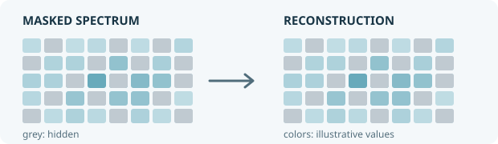
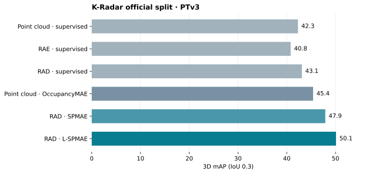

레이더가 받은 신호를 물체 탐지에 사용하기 전, 보통 약한 반사는 걸러내고 남은 신호를 점군으로 만든다. 잡음이 줄고 데이터도 작아지지만, 그 과정에서 도움이 될 만한 정보까지 함께 사라질 수 있다. 그렇다면 **걸러내기 전 스펙트럼을 모델에 보여 주면 물체를 더 잘 찾을 수 있을까?**

NeurIPS 2026 논문 *Rethinking Radar 3D Perception*의 답은 조건부로 그렇다. K-Radar 공식 분할에서 같은 PTv3 검출기를 지도 학습했을 때, 스펙트럼의 3D mAP는 43.1로 점군의 42.3과 비슷했다. 스펙트럼을 자기지도 사전학습한 뒤 미세조정하자 50.1이 됐다. 비교한 점군 기반 자기지도 방법 중 최고점은 45.4였다. [논문 표 1](https://arxiv.org/html/2611.12334v1#S5.SS1)

대신 처리 비용은 늘었다. 단일 NVIDIA B200, 배치 크기 8의 측정에서 4D 스펙트럼의 추론 처리량은 초당 1.3회, 점군은 14.3회였다. 이 수치는 **배치 단위 처리량**이다. 차량에서 한 프레임을 처리하는 지연시간으로 받아들이면 안 된다. [논문 부록 D](https://arxiv.org/html/2611.12334v1#A4)

## 1. 논문 정보

| 항목 | 내용 |
|---|---|
| 제목 | Rethinking Radar 3D Perception: Representation Learning from Raw Spectra |
| 저자 | Miao Zhang, Mohamed Abdelsamad, Bin Yang, Sherif Abdulatif, Benedikt Loesch, Marco Altmann, Abhinav Valada, Bin Yang |
| 소속 | Bosch Research, University of Stuttgart, University of Freiburg. Zhang과 Abdelsamad는 공동 제1저자 |
| 학회 | NeurIPS 2026 |
| 읽은 판본 | arXiv:2611.12334v1, 2026년 11월 9일 제출 |

[arXiv 논문](https://arxiv.org/abs/2611.12334) · [NeurIPS 공식 목록](https://neurips.cc/Downloads/2026) · [연구실 논문 목록](https://rl.uni-freiburg.de/publications)

수치는 논문에 보고된 결과다. 별도로 학습이나 재현 실험을 수행하지 않았다.

| 질문 | 논문의 답 |
|---|---|
| 문제 | 점군을 만드는 과정에서 약하지만 유용한 레이더 정보도 사라질 수 있다. |
| 방법 | FFT 이후의 조밀한 스펙트럼 일부를 가리고 복원하도록 자기지도 사전학습한다. |
| 결과 | K-Radar 공식 분할에서 3D mAP 50.1. 비교한 점군 기반 SSL 최고점은 45.4다. |
| 비용과 한계 | 더 많은 연산과 메모리가 필요하다. 배치 처리량만으로 차량 내 실시간성을 판단할 수 없다. |

## 2. 레이더 스펙트럼과 점군은 어떻게 다를까?

자동차 레이더는 전파를 보내고 되돌아온 신호를 측정한다. 이 신호를 FFT(고속 푸리에 변환) 등으로 처리하면 거리, 방향, 높이와 도플러 속도에 따른 반사 에너지 분포를 얻는다. 도플러는 레이더와 물체 사이의 상대적인 움직임과 관련된다.

이 논문에서 **raw spectrum**은 센서가 디지털화한 ADC 원신호 자체가 아니다. **FFT 이후에도 값들을 조밀하게 유지하고, 점군화 같은 수작업 축소를 거치지 않은 스펙트럼**을 뜻한다. 논문은 거리(Range), 방위각(Azimuth), 고각(Elevation), 도플러(Doppler)의 네 축을 가진 데이터를 다룬다. K-Radar는 스펙트럼을 제공하고, RADIal에서는 연구진이 공개된 ADC 신호로부터 스펙트럼을 구성했다. [논문 §1·§4.1](https://arxiv.org/html/2611.12334v1#S4.SS1)

점군은 이 분포에서 후보 반사를 선별해 위치와 특징으로 나타낸 것이다. 예를 들어 CFAR 같은 탐지 절차는 주변 신호를 참고해 반사 후보를 고른다. 남은 점은 다루기 편하지만, 선택 과정에서 빠진 약한 반사나 주변 분포는 나중에 복구할 수 없다. 반대로 스펙트럼에는 더 많은 측정값과 잡음, 클러터가 함께 남는다. 따라서 정보가 많다는 사실만으로 모델이 그 정보를 잘 활용한다고 보장할 수는 없다.

여기서 말하는 점군은 **레이더 점군**이다. LiDAR 점군을 비교 대상으로 바꿔 읽으면 안 된다.

## 3. 지도 학습만으로는 왜 충분하지 않을까?

지도 학습에서는 사람이 표시한 물체의 종류와 3D 경계 상자를 정답으로 사용한다. 모델이 예측한 자동차의 위치나 크기가 정답과 다르면 그 차이를 줄이도록 학습한다. 정답 상자가 스펙트럼의 각 값이 잡음인지 유용한 반사인지 직접 알려 주지는 않는다.

연구진의 가설은 이렇다. 조밀한 스펙트럼에는 활용할 정보가 더 있지만, 탐지 정답만으로는 모델이 그 구조를 배우기 어려울 수 있다. 이를 살펴보기 위해 같은 PTv3 백본에 점군과 스펙트럼을 넣어 비교했다. 실제로 공식 분할에서 일반 지도 학습만 한 두 입력의 3D mAP 차이는 작았고, 다른 스펙트럼 표현인 RAE는 점군보다 낮았다. 이것은 **해당 설정의 결과**다. 모든 감독 학습 모델에서 스펙트럼이 불리하다는 뜻은 아니다. [논문 §3.1·표 1](https://arxiv.org/html/2611.12334v1#S3.SS1)

자기지도 학습(SSL)은 데이터 자체에서 학습 문제와 정답을 만든다. 이 논문은 스펙트럼의 일부를 가리고 나머지를 보고 원래 값을 예측하게 한다. 사람이 상자를 그리지 않아도 복원 문제를 만들 수 있다. 이후에는 사전학습한 인코더에 탐지기를 붙여 **사람이 표시한 정답으로 다시 미세조정**한다. 따라서 최종 탐지 학습과 평가까지 정답 라벨이 필요 없다는 뜻은 아니다.

## 4. 무엇을 가리고, 어떻게 복원할까?

연구진의 기본 방법인 SPMAE는 스펙트럼의 일부 위치를 무작위로 가린다. 보이는 위치를 인코더에 넣고, 디코더가 가려진 위치의 원래 특징을 예측한다. 복원 오차는 가려진 위치에서만 계산한다. 예를 들어 주변 거리·각도 구간에서 연속된 반사 패턴이 보인다면, 모델은 가려진 칸의 값을 주변 맥락으로 추정하도록 훈련된다. 이는 이해를 위한 예시이며, 특정 물체를 정확히 복원했다는 실험 결과는 아니다.

*SPMAE의 마스킹과 복원을 단순화한 개념도. 실제 레이더 측정값이나 모델의 예측 결과가 아니다. 애니메이션은 웹 브라우저에서 재생된다.*

가려진 위치의 집합을 \(S_m\), 보이는 위치를 \(S_v\), 원래 특징을 \(f_i\), 인코더와 디코더를 각각 \(E\), \(D\)라고 쓰면 논문의 복원 손실은 다음과 같다. \(t_i\)는 가려진 위치를 나타내는 토큰이다.

$$
\mathcal{L}_{\mathrm{SPMAE}} = \frac{1}{|S_m|}\sum_{i\in S_m}\left\|D\left(E(S_v),t_i\right)-f_i\right\|_1
$$

즉 가려진 칸의 예측값과 원래 값 사이의 절대 오차를 평균한다. 원래 값에 잡음이 섞여 있으므로 이것은 깨끗한 정답 신호를 복원하는 문제와 같지 않다. 연구진은 이웃으로부터 예측 가능한 구조가 표현 학습에 도움이 된다고 설명하지만, 이것을 신호와 잡음의 완벽한 분리에 대한 증명으로 제시하지는 않는다. 반복되는 클러터나 다중 경로 반사도 예측 가능한 구조에 포함될 수 있다. [논문 §3.1–3.2](https://arxiv.org/html/2611.12334v1#S3)

### L-SPMAE: 레이더에서 나타나는 퍼짐도 반영하기

실제 스펙트럼에서는 하나의 반사 에너지가 정확히 한 칸에만 머물지 않고 주변 칸으로 퍼질 수 있다. 이를 이해하는 데 **spectral leakage**, 즉 스펙트럼 누출이 도움이 된다. 유한한 길이로 측정한 신호를 주파수 영역으로 바꾸면 측정 구간의 영향이 주파수 성분 주변으로 퍼지는 현상이다.

L-SPMAE는 기본 마스킹에 이 현상에서 착안한 변형을 더한다. 먼저 스펙트럼 위치를 무작위로 가린 뒤, 보이는 부분에 이웃 칸으로 에너지를 퍼뜨리는 변형을 적용한다. 모델은 이렇게 불완전하고 변형된 주변 정보를 보고 **변형하기 전 원래 스펙트럼의 가려진 값**을 복원한다. 디코더는 사전학습을 위한 것이고, 이후 물체 탐지에는 학습된 인코더를 사용한다. 이 변형은 실제 하드웨어의 누출 통계를 그대로 재현하도록 만든 것은 아니다. [논문 §3.3](https://arxiv.org/html/2611.12334v1#S3.SS3)

논문은 시간·측정 영역에서 윈도우를 곱하면 주파수 영역에서 컨볼루션이 된다는 관계를 동기로 사용한다.

$$
\operatorname{DFT}(z\odot m)=\operatorname{DFT}(z)\circledast\operatorname{DFT}(m)
$$

\(z\)는 측정 신호, \(m\)은 측정 위치를 선택하는 윈도우, \(\odot\)는 위치별 곱, \(\circledast\)는 순환 컨볼루션이다. 실제 구현은 이 관계에서 영감을 얻은 커널을 스펙트럼에 적용한다. 위 식 자체가 구현의 모든 세부 사항을 나타내는 것은 아니다.

### 도플러 축을 따로 두는 이유

같은 스펙트럼이라도 모델에 어떤 축으로 보여 주느냐에 따라 결과가 달라졌다.

| 표현 | 공간 좌표와 특징 | 도플러 정보 |
|---|---|---|
| RAE | 거리·방위각·고각에서 만든 \((x,y,z)\) 좌표 | 도플러 전력을 평균해 특징으로 사용 |
| RAE-d | \((x,y,z)\) 좌표 | 도플러 칸을 특징 채널에 쌓음 |
| RAD | \((x,y,\text{Doppler})\) 좌표 | 도플러를 모델이 다루는 축으로 두고 고각을 특징 채널로 사용 |

RAE-d와 RAD는 도플러 정보를 남기지만 배치 방식이 다르다. 논문에서 RAE-d를 채널로 쌓는 방식은 평균을 쓴 RAE보다 좋은 결과를 내지 못했다. RAD는 도플러를 좌표 축으로 드러내 이 축의 관계를 모델이 학습하도록 했다. RAD의 세 번째 좌표는 **높이가 아니라 도플러**이며, 높이 관련 정보는 특징 채널에 들어간다. [논문 §3.4](https://arxiv.org/html/2611.12334v1#S3.SS4)

## 5. 실험은 어떻게 비교했나?

대표 실험은 K-Radar 공식 분할에서 Sedan, Bus/Truck, Pedestrian 세 종류의 물체를 탐지한다. 기준 백본은 PTv3이며, 자기지도 사전학습 후에는 인코더와 탐지 헤드를 함께 미세조정했다. 논문은 별도로 인코더를 고정하는 probing 실험도 보고하지만, 아래 표는 **미세조정 결과**다. 사전학습은 60,000회 반복하고, 미세조정은 배치 8로 20 epoch 진행했다. SPMAE의 마스킹 비율은 0.7, L-SPMAE는 마스킹 0.4와 누출 비율 0.2를 사용했다. [논문 §4](https://arxiv.org/html/2611.12334v1#S4)

평가지표는 AP를 세 물체 종류에 대해 평균한 mAP다. AP는 예측 점수 기준을 바꿔가며 정밀도와 재현율의 관계를 요약한 지표다. 여기서 BEV는 위에서 내려다본 위치, 3D는 높이까지 포함한 입체 상자의 겹침으로 평가하며, K-Radar에서는 IoU 임계값 0.3을 썼다. **mAP 50.1은 물체의 50.1%를 찾았다는 뜻이 아니다.**

### 입력과 학습 방법을 함께 비교하면

| 입력 | 학습 | BEV mAP | 3D mAP |
|---|---|---:|---:|
| 레이더 점군 | 지도 학습 | 49.0 | 42.3 |
| RAE 스펙트럼 | 지도 학습 | 47.4 | 40.8 |
| RAD 스펙트럼 | 지도 학습 | 48.9 | 43.1 |
| 레이더 점군 | OccupancyMAE 사전학습 후 미세조정 | 50.4 | 45.4 |
| RAD 스펙트럼 | SPMAE 사전학습 후 미세조정 | 54.3 | 47.9 |
| RAD 스펙트럼 | L-SPMAE 사전학습 후 미세조정 | **55.9** | **50.1** |

*K-Radar 공식 분할, IoU 0.3, 세 클래스 평균. [논문 표 1](https://arxiv.org/html/2611.12334v1#S5.SS1). 점군 기반 SSL의 3D mAP 최고점은 표에 표시한 OccupancyMAE다.*

*논문 표 1을 바탕으로 다시 그렸다. 점군과 스펙트럼은 데이터 표현과 사전학습 방식이 함께 다르므로 50.1과 45.4의 차이를 입력 하나만의 효과로 해석할 수 없다.*

RAD 입력을 고정하면 지도 학습 43.1 → SPMAE 47.9 → L-SPMAE 50.1이다. 이 비교에서는 마스킹 사전학습과 누출 기반 변형을 추가했을 때 결과가 각각 좋아졌다. 다만 SPMAE와 L-SPMAE는 마스킹 비율 등 설정도 다르므로, 개선을 단일 요소의 순수한 인과 효과로 단정하기는 어렵다. 점군 SSL 방법과 스펙트럼 SSL 방법은 사전학습 방식도 다르다.

반대로 도플러 축의 배치에 주목하면, L-SPMAE 미세조정 결과가 RAE-d 46.8, RAD 50.1이다. 논문은 이를 도플러를 독립 축으로 모델링하는 이점으로 해석한다. 구조 변경의 효과를 보여 주는 결과지만 모든 아키텍처에서 같은 차이가 난다는 보장은 없다.

### 다른 분할과 데이터셋에서도 같을까?

K-Radar 공식 분할은 같은 주행 시퀀스의 일부가 학습과 평가에 나뉘어 들어갈 수 있다. 연구진은 더 엄격하게 시퀀스 단위로 나눈 분할도 평가했다. 이때 L-SPMAE RAD의 3D mAP는 공식 분할의 50.1에서 **29.2**로 내려갔다. 같은 시퀀스 분할에서 지도 학습 RAD는 24.6이었다. 분할에 따라 난도가 크게 달라지므로 두 실험의 숫자를 하나의 순위표처럼 섞으면 안 된다. [논문 부록 A.1·표 13](https://arxiv.org/html/2611.12334v1#A2.SS1)

RADIal에서는 BEV 기준, IoU 0.5에서 FFTRadNet 89.3, 지도 학습 PTv3 89.0, L-SPMAE 90.0을 보고했다. K-Radar보다 개선 폭은 작으며, 지표와 임계값이 다르므로 K-Radar의 3D mAP와 직접 비교할 수 없다. 연구진은 차이를 데이터의 장면 다양성과 복잡도 차이로 추정한다. 이는 확인된 원인이라기보다 저자의 해석이다. [논문 표 3·§5.3](https://arxiv.org/html/2611.12334v1#S5.SS3)

정답 데이터의 양을 줄이는 실험도 있다. K-Radar 공식 분할에서 L-SPMAE는 라벨의 25%로 미세조정해 3D mAP 44.4를 얻었고, 라벨 100%로 처음부터 지도 학습한 RAD의 43.1을 넘었다. 이 결과가 자기지도 사전학습용 데이터까지 25%만 필요했다는 뜻은 아니다. [논문 부록 표 17](https://arxiv.org/html/2611.12334v1#A2.SS4)

연구진은 이 밖에도 점유 예측과 다중 물체 추적을 평가했다. 점유 예측에서 L-SPMAE는 51.2m 범위의 전경 IoU가 26.5로 RadarOcc의 20.8보다 높았지만, 배경 IoU는 29.1로 RadarOcc의 30.6보다 낮았다. 모든 종류의 예측이 일괄적으로 개선된 것은 아니다. [논문 표 4·부록 표 16](https://arxiv.org/html/2611.12334v1#S5.SS3)

## 6. 성능 향상에 드는 계산 비용

논문은 조밀한 RAE 큐브의 데이터 크기가 대응하는 희소 점군의 약 10배라고 설명한다. 처리 시간 비교는 같은 PTv3 검출기와 단일 NVIDIA B200에서, **한 iteration에 배치 8개**를 넣은 조건이다.

| 입력 | 학습 처리량 (iteration/s) | 추론 처리량 (iteration/s) |
|---|---:|---:|
| 점군 | 6.7 | 14.3 |
| 3D 스펙트럼 | 1.7 | 3.0 |
| 4D 스펙트럼 | 0.7 | 1.3 |

*단일 NVIDIA B200, 배치 크기 8. 구현은 하드웨어에 완전히 최적화되지 않았다고 저자가 명시했다. [논문 부록 D, 표 18](https://arxiv.org/html/2611.12334v1#A4)*

보고된 추론 처리량을 나누면 점군이 4D 스펙트럼보다 약 11배 높다. 초당 몇 번의 **배치**를 처리했는지이므로 1.3을 1.3 FPS로 읽으면 안 된다. 배치 8이 모두 유효한 프레임이라는 가정 아래 단순 곱하면 약 10.4프레임/초에 해당하지만, 이것도 배치 1에서 한 장을 받자마자 결과를 내는 지연시간이나 차량 전체 파이프라인의 FPS는 아니다. 논문은 이 표에서 센서 입력, FFT, 데이터 전송, 전처리·후처리 등 각 단계의 포함 범위를 상세히 분리하지 않는다.

배치 8에서 연구진은 학습에 최소 50GB, 추론에 13GB GPU 메모리가 필요하다고 밝힌다. 이 문장의 메모리는 모델 파일 크기나 차량용 메모리 요구량이 아니다. B200의 배치 처리 결과를 차량용 SoC의 지연시간·전력·발열로 환산할 수도 없다. [논문 부록 C–D](https://arxiv.org/html/2611.12334v1#A3)

## 7. 자율주행 시스템에서 읽어 볼 점

**논문에서 관찰한 것:** K-Radar와 RADIal의 실험 설정에서 스펙트럼 자기지도 사전학습은 비교한 탐지 결과를 높였다. 점유 예측과 추적에서도 별도의 결과를 보고했다. 동시에 스펙트럼 처리의 계산 비용이 컸고, 더 엄격한 시퀀스 분할에서 탐지 점수는 상당히 낮아졌다.

**여기서부터는 시스템 관점의 해석이다.** 레이더가 제공하는 상대 속도와 약한 반사 주변의 정보를 인지 모델에 더 남길 수 있다는 점은 흥미롭다. 하지만 모델의 벤치마크 점수가 올라갔다고 곧바로 긴급 제동이나 전체 주행의 안전성이 향상됐다고 할 수는 없다. 실제 적용을 판단하려면 다음 질문이 남는다.

1. 차량용 하드웨어에서 배치 1로 센서 입력부터 최종 물체 목록까지 걸리는 지연시간과 전력은 얼마인가? 장면이 복잡할 때 지연시간의 최악 또는 상위 백분위는 어떻게 변하는가?
2. 다른 제조사의 레이더, 안테나 배열, FFT 설정, 장착 위치에서도 성능이 유지되는가? 센서 간 데이터 형식과 보정 차이는 어떻게 처리하는가?
3. 거리·가림·날씨·물체 크기별로 놓치는 사례와 오탐이 어떻게 달라지는가? 특히 드문 보행자·자전거 사례가 충분한가?
4. 시간 정보를 쓰는 추적기와 카메라·LiDAR 융합까지 연결했을 때 성능과 전체 지연시간이 어떻게 바뀌는가?

논문의 4클래스 실험에서는 자전거 AP가 지도 학습 대비 사전학습 후 낮아진 사례도 있다. 연구진은 적은 학습 표본을 원인으로 추정한다. 클래스별 성능과 데이터 구성까지 살펴야 하는 이유다. [논문 표 5](https://arxiv.org/html/2611.12334v1#S5.SS3)

## 8. 정리

이 논문에서 눈여겨볼 부분은 스펙트럼을 넣었다는 사실만이 아니다. **어떤 정보를 남기고, 그 정보를 모델이 어떤 방식으로 배우게 할지**를 함께 바꿨다는 점이다. 비교 실험에서 자기지도 사전학습과 도플러 축의 구성은 탐지 결과를 바꿨다.

다만 정보 보존의 대가는 뚜렷하다. 다음 단계는 이 결과가 실제 센서와 차량용 하드웨어에서도 유지되는지, 그리고 추가 비용을 감당할 만큼 어려운 주행 장면에서 이점이 있는지 확인하는 일이다.

## 참고자료

1. Zhang 외, [Rethinking Radar 3D Perception: Representation Learning from Raw Spectra](https://arxiv.org/abs/2611.12334), arXiv v1, 2026. [본문과 부록](https://arxiv.org/html/2611.12334v1).
2. [NeurIPS 2026 공식 논문 목록](https://neurips.cc/Downloads/2026), [University of Freiburg 연구실 논문 목록](https://rl.uni-freiburg.de/publications).
3. Paek 외, [K-Radar 데이터셋과 공식 코드](https://github.com/kaist-avelab/K-Radar).
4. [RADIal 데이터셋과 FFTRadNet 코드](https://github.com/valeoai/RADIal), [기본 평가 지표 관련 이슈](https://github.com/valeoai/RADIal/issues/46).
5. Pointcept Contributors, [Pointcept](https://github.com/Pointcept/Pointcept): 논문에서 사용한 3D 인지 코드베이스 중 하나.
